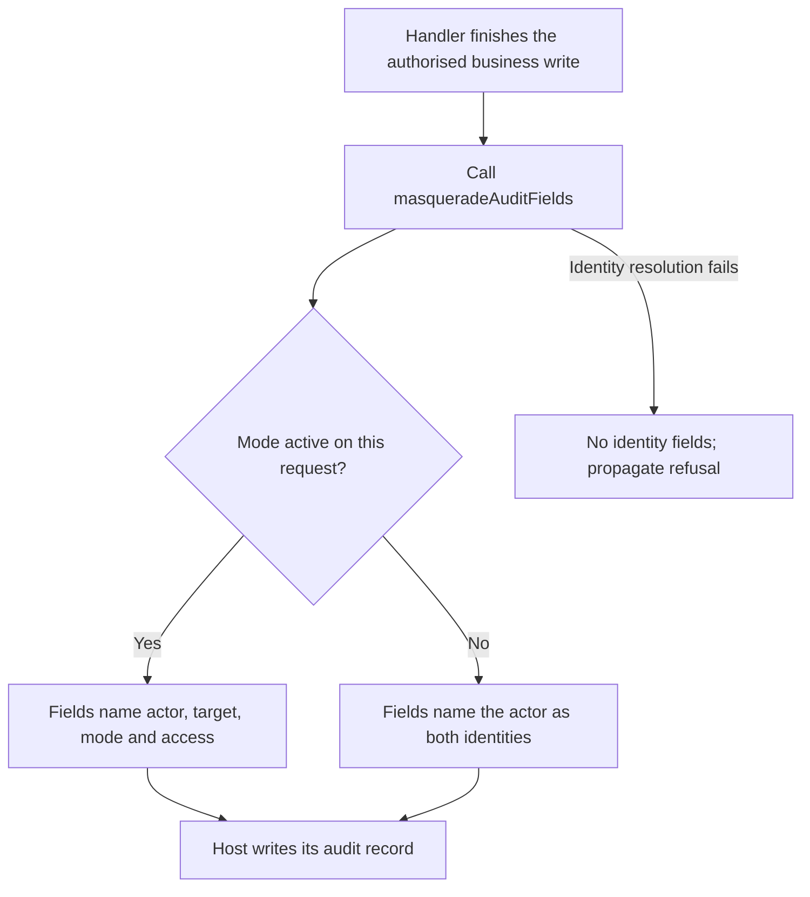
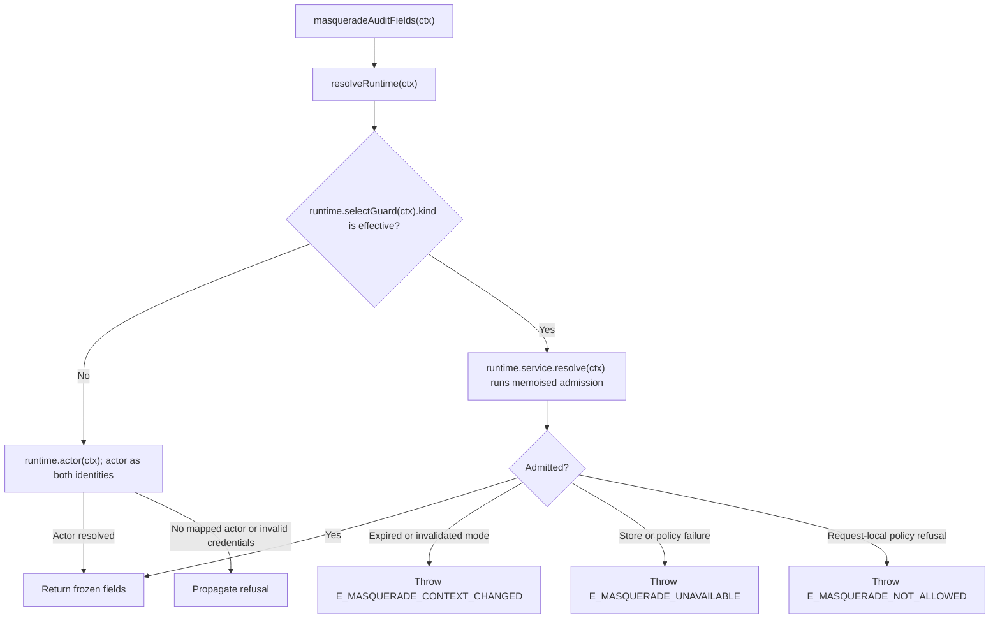

# US-AUDIT-01 — Attach actor and target identity to a host audit record

As an application developer, I want the safe actor and effective identity fields for the current request so that my own business audit record shows who acted and whose account was affected.

**Status:** Current; source-reviewed helper, not runtime-tested.
**Access:** Host handler on a route covered by the Masquerade auth setup, after the host's own authorisation and business write.
**Entry:** `await masqueradeAuditFields(ctx)` from `@kevinjohn/adonisjs-masquerade/http`, spread into the host's audit writer.
**Documentation:** [Audit business work](../../docs/guide/audit.md).
**Source:** [masqueradeAuditFields](../../http/audit_fields.ts).
**Coverage:** [Audit field tests](../../tests/http_audit_fields.spec.ts).

## Acceptance criteria

- The returned frozen object always has the keys `actorId`, `actorIncarnation`, `effectiveId`, `effectiveIncarnation`, `isMasquerading`, `modeId` and `access`.
- On a raw route with a single mapped actor adapter, both identities are the actor, `isMasquerading` is `false`, `modeId` and `access` are `null`, and no mode is admitted, invalidated or reported.
- An ambiguous or unmapped native selection cannot supply actor fields. The helper propagates the runtime failure before the host can record an identity.
- On an effective route during an admitted active mode, the effective identity is the target and `modeId` and `access` come from the mode.
- The package writes no business audit record; the host's writer and transaction own persistence. The package's own control ledger stays separate.

## User flow

## Code flow

Scope: field resolution only; the host audit writer is application-owned.

**Code references:** [audit fields](../../http/audit_fields.ts), [audit guide](../../docs/guide/audit.md).
