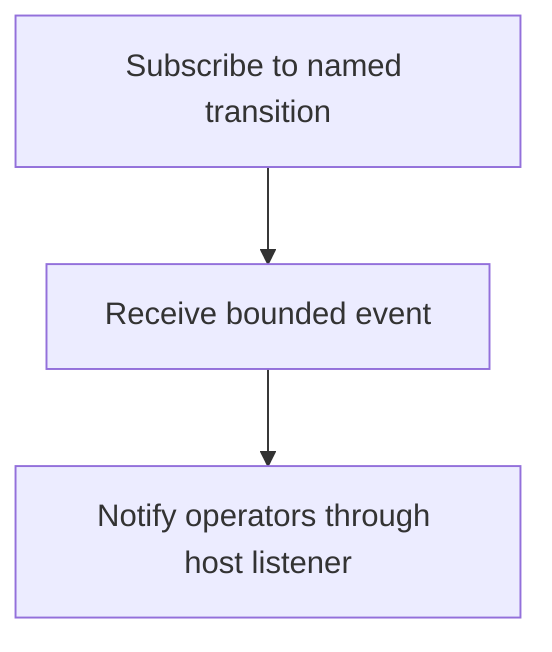
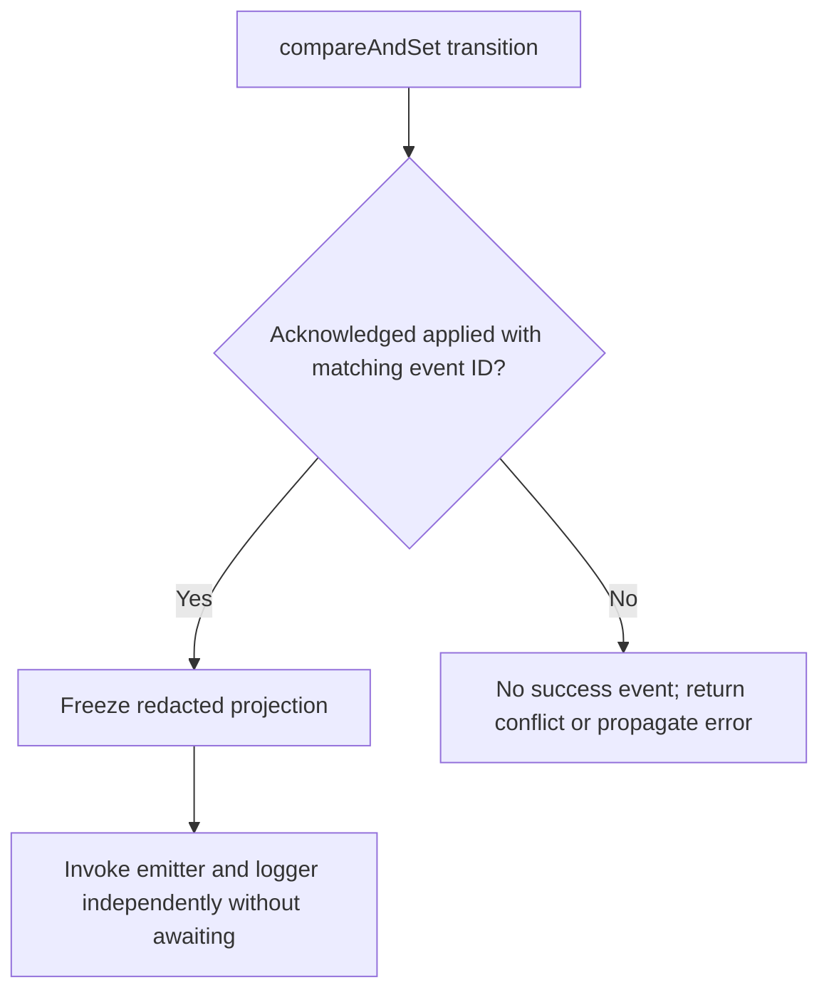

# US-AUDIT-02 — Observe committed transitions

As an application developer, I want to subscribe to support transitions so that operators can receive alerts with bounded identity fields.

**Status:** Current under the stated integration.
**Access:** Application developer
**Entry:** Register listeners using the provider’s AdonisJS event declarations.
**Documentation:** [Alerts](../../docs/guide/alerts.md).
**Source:** [Observer delivery](../../src/observers.ts), [Typed event names](../../providers/masquerade_provider.ts).
**Coverage:** [Commit and observer failures](../../tests/core_failures.spec.ts), [Alert recipe](../../tests/docs_alerts_recipe.spec.ts).

## Acceptance criteria

- Listen for `masquerade:started`, `masquerade:stopped`, `masquerade:expired` and `masquerade:invalidated`. Each committed transition supplies a frozen projection with its ledger event ID and no start reason.
- Denied and no-op controls emit no transition. Unknown commit acknowledgements do not emit a success. Inspect authoritative status before taking further action.
- Emitter and info logger callbacks run independently. Throws, rejected promises and indefinitely pending observers do not change the committed result. Delivery to an external alert destination remains the host’s responsibility.

## User flow

## Code flow

**Code references:** [Transition acknowledgement](../../src/mode_transition.ts#L50), [observer delivery](../../src/observers.ts#L41), [provider event types](../../providers/masquerade_provider.ts).
