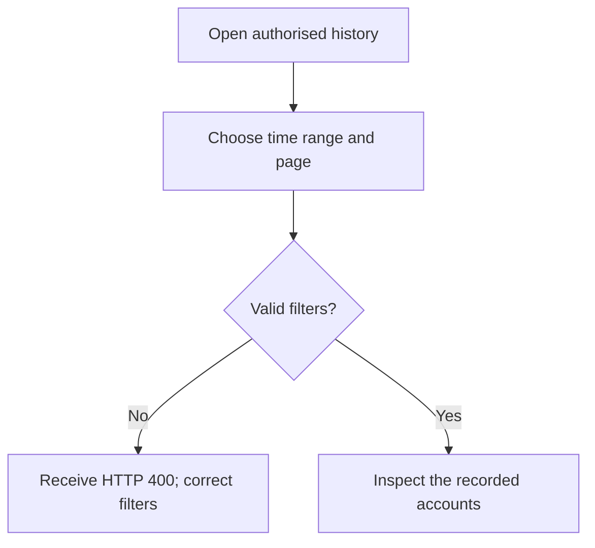
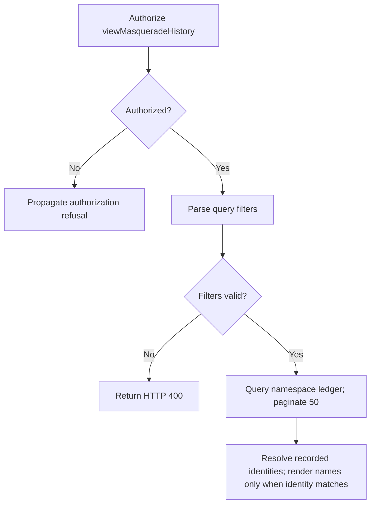

# US-AUDIT-03 — Review a page of transition history

As an authorised host reviewer, I want to filter the control ledger by time so that I can investigate historical actions without misidentifying a reused account ID.

**Status:** Current under the stated integration.
**Access:** Reviewer authorised by the host
**Entry:** Host recipe for GET /admin/masquerade-history. The host mounts the raw route and supplies its ability and view.
**Documentation:** [History recipe](../../docs/guide/audit.md).
**Source:** [History controller](../../examples/native-session/app/controllers/masquerade_history_controller.ts), [Date and page parsing](../../examples/native-session/app/services/audit_history_query.ts), [Historical identity](../../examples/native-session/app/services/audit_history_identity.ts).
**Coverage:** [Query validation](../../tests/audit_history_query.spec.ts), [Identity resolution](../../tests/audit_history_identity.spec.ts), [Recipe parity](../../tests/docs_audit_recipe.spec.ts).

## Acceptance criteria

- Authorise viewMasqueradeHistory before parsing or querying. Optional from and to accept ISO dates normalised to UTC. Page defaults to 1 and must be a positive safe integer supplied as canonical decimal text. Invalid filters give HTTP 400.
- Limit results to the configured namespace. Include from, exclude to and order by descending event time then ID. Return up to 50 entries per page.
- Show a current name only when inspection matches both recorded ID and incarnation. Otherwise fall back to the recorded ID. The host must restrict access to historical reasons.

## User flow

## Code flow

