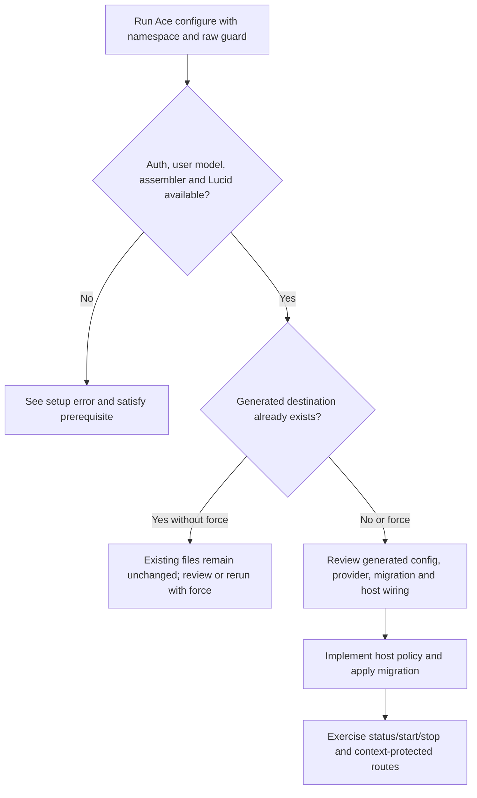
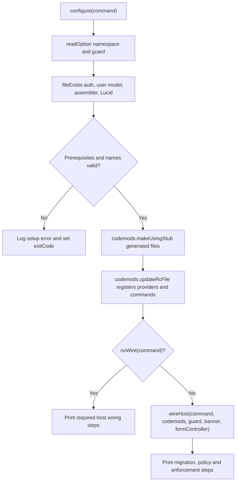

# US-SETUP-01 — Configure policy, authority and request wiring

As an AdonisJS application developer, I want to scaffold and finish Masquerade integration so that control routes and business requests use the host's intended identity and policy boundaries.

**Status:** Operator; current Ace setup path.
**Access:** Application developer with permission to configure providers, routes, middleware and schema.
**Entry:** `node ace configure @kevinjohn/adonisjs-masquerade`; host config is completed from the emitted steps.
**Documentation:** [Setup guide](../../docs/guide/setup.md), [configuration guide](../../docs/guide/getting-started.md).
**Source:** [configure](../../configure.ts), [host wiring](../../src/configure_wiring.ts), [config validation](../../src/define_config.ts).
**Coverage:** [Configure tests](../../tests/configure.spec.ts), [host wiring tests](../../tests/configure_wiring.spec.ts).

## Acceptance criteria

- The command requires configured Adonis auth, a resolvable user model, assembler and Lucid. It accepts the configured namespace and raw guard; invalid values stop with an error.
- Existing generated files are preserved unless `--force` is supplied. Optional `--banner` and `--form-controller` add those host scaffolds; `--no-wire` leaves auth/kernel/routes wiring steps for the maintainer.
- The command creates configuration, native authority/user provider/context middleware and migration stubs, registers provider and Ace commands, and wires recognized auth/kernel/route shapes when enabled.
- Host completes account incarnation, security stamp, active-account and deny-by-default `canMasquerade` policy behavior, reviews and applies the migration, and verifies context enforcement before enforcing it.
- `defineConfig` normalizes and validates config. Custom authorities/stores are explicit host integrations; this scaffold does not infer their policy.

## User flow

## Code flow

Scope: Ace codemod scaffolding and recognized host wiring; host-specific policy implementation remains application-owned.

**Code references:** [configure](../../configure.ts), [wireHost](../../src/configure_wiring.ts), [defineConfig](../../src/define_config.ts), [setup guide](../../docs/guide/setup.md).
