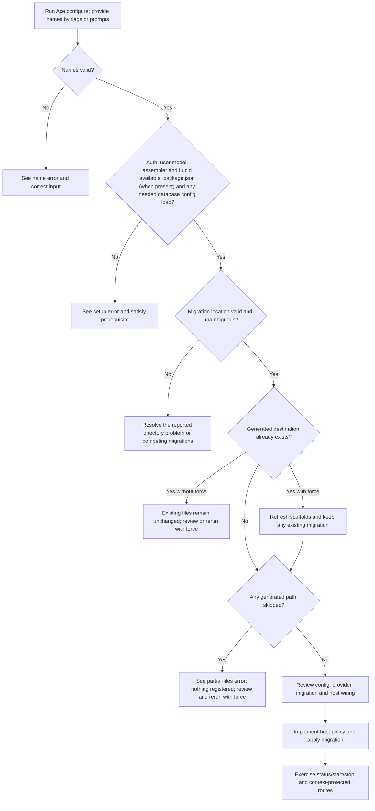
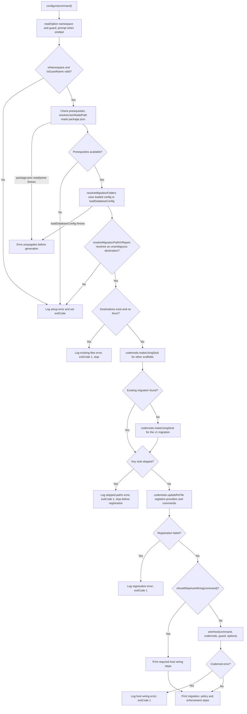

# US-SETUP-01 — Configure policy, authority and request wiring

As an AdonisJS application developer, I want to scaffold and finish Masquerade integration so that control routes and business requests use the host's intended identity and policy boundaries.

**Status:** Operator; current Ace native-session scaffold.
**Access:** Application developer with permission to configure providers, routes, middleware and schema.
**Entry:** `node ace configure @kevinjohn/adonisjs-masquerade`; host config is completed from the emitted steps.
**Documentation:** [Setup guide](../../docs/guide/setup.md), [configuration guide](../../docs/guide/getting-started.md).
**Source:** [configure](../../configure.ts), [host wiring](../../src/configure_wiring.ts), [config validation](../../src/define_config.ts).
**Coverage:** [Configure tests](../../tests/configure.spec.ts), [host wiring tests](../../tests/configure_wiring.spec.ts).

## Acceptance criteria

| Input             | Control                                          | Required/default/conditions                                                    |
| ----------------- | ------------------------------------------------ | ------------------------------------------------------------------------------ |
| Namespace         | `--namespace` or **Masquerade namespace** prompt | Required; no default. 1–128 ASCII bytes matching `[A-Za-z0-9][A-Za-z0-9_.:-]*` |
| Raw session guard | `--guard` or **Raw session guard name** prompt   | Required; no default. 1–128 ASCII bytes matching `[A-Za-z][A-Za-z0-9_-]*`      |

- Omitted flags prompt for their values. Invalid names stop with an error before scaffolding.
- The command requires configured AdonisJS auth, a resolvable user model, assembler and Lucid. An existing `package.json` that cannot be read or is not JSON stops the command with that error before files are written; if absent, the model directory fallback is used. When no database config is already loaded, configure imports `database.ts` from the host config directory; if that file exists but fails to load, the error stops the command before files are written. Configure resolves the user model from the host import map, falling back to the AdonisRC models directory. The default Lucid connection’s migration directories take precedence over the AdonisRC migrations directory. Configure searches those directories for an existing Masquerade migration before selecting a destination. Multiple matches stop configure before it writes files. Generated services, providers, controllers, middleware, config, start files and views follow their respective host directories.
- Without `--force`, any existing generated destination stops the command with an error and exit code 1 before files are written; if a stub is nonetheless skipped, the command stops with exit code 1 before providers or commands are registered. `--force` replaces other generated files and preserves the existing migration’s path and contents. Optional `--banner` and `--form-controller` add those host scaffolds; `--no-wire` leaves auth/kernel/routes wiring steps for the maintainer.
- The command creates native-session configuration, authority/user provider and, on first setup, a migration using the fixed v1 schema helpers, registers provider and Ace commands, and wires recognised session auth/kernel/route shapes when enabled; the kernel edit registers the package's `masquerade_context_middleware` subpath.
- Native opaque access-token integration is host-configured separately with an effective token guard and authority, as described in the [access-token guide](../../docs/guide/access-tokens.md). Configure does not automatically wire token authentication.
- Host completes account incarnation, security stamp, active-account and deny-by-default `canMasquerade` callback behaviour, reviews and applies the migration, and verifies context enforcement before enforcing it.
- `defineConfig` normalises and validates supplied values. To defer native adapter or policy wiring until provider boot, follow [US-SETUP-03](us-setup-03-register-integration-callbacks.md). Custom authorities/stores are explicit host integrations; this scaffold does not infer their policy.

## User flow

## Code flow

Scope: Ace native-session scaffolding and recognised session host wiring; host-specific policy implementation remains application-owned.

**Code references:** [configure](../../configure.ts), [wireHost](../../src/configure_wiring.ts), [defineConfig](../../src/define_config.ts), [v1 schema](../../stores/lucid_schema.ts), [setup guide](../../docs/guide/setup.md).
