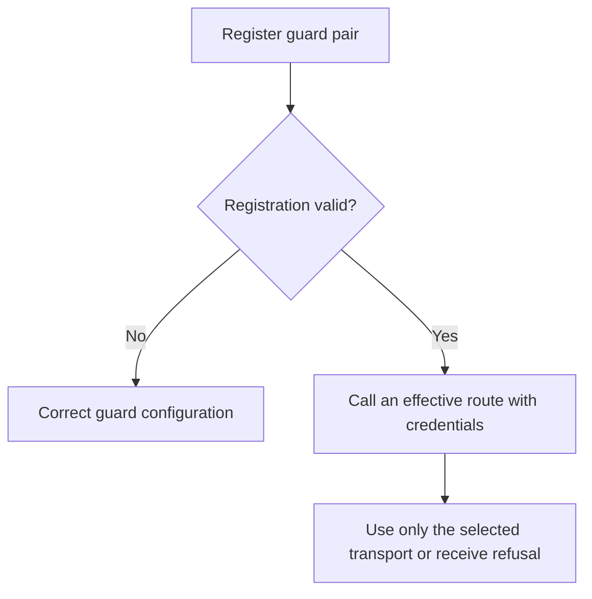
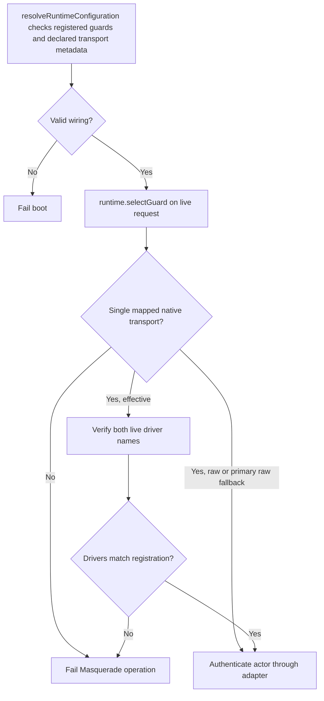

# US-SETUP-02 — Select the credential transport for each route

As an application developer, I want to bind each effective guard to the intended native credential so that a request carrying both a cookie and a bearer token resolves the correct actor.

**Status:** Current under the stated integration.
**Access:** Application developer
**Entry:** Host auth configuration and native adapter registration.
**Documentation:** [Access tokens](../../docs/guide/access-tokens.md).
**Source:** [Runtime](../../src/integration/runtime_factory.ts), [Route selection](../../src/integration/route_guard_selection.ts).
**Coverage:** [Live guard configuration](../../tests/runtime_guard_configuration.spec.ts), [Route selection](../../tests/route_guard_selection.spec.ts).

## Acceptance criteria

- Register the primary raw guard and a matching adapter for each integrated raw transport. Configure an effective default guard. A missing raw factory, unbound effective factory, missing effective transport metadata or a mismatch between declared driver names fails configuration.
- `nativeAuthorities(primary, additional)` requires unique raw guard names and the exact same authority object for each additional adapter; nested compositions are refused. A standalone token authority accepts its own namespace, incarnation, stamp and active checks, or it can share an existing authority. [Native composition](../../native/native_authorities.ts), [token authority](../../native/access_tokens_authority.ts)
- On an effective route the runtime constructs the selected guards with the live request and compares both driver names before authenticating the actor or reading the store. A cross-wired factory fails with `E_MASQUERADE_UNAVAILABLE`.
- The Account Kit 0.6.1 raw session guard reports `driverName: 'session'` and can be wrapped by the effective session guard. An adapter can omit its driver declaration at boot; live guards must still match. [Session guard coverage](../../tests/effective_session_guard.spec.ts#L330)
- On the token route the token adapter supplies the actor even if a different actor has a session cookie. Unrelated raw guards can still serve native routes. An ambiguous or unbound raw selection cannot enter the Masquerade service.

## User flow

## Code flow

**Code references:** [Runtime validation and request authentication](../../src/integration/runtime_factory.ts#L71), [route selection](../../src/integration/route_guard_selection.ts#L23).
