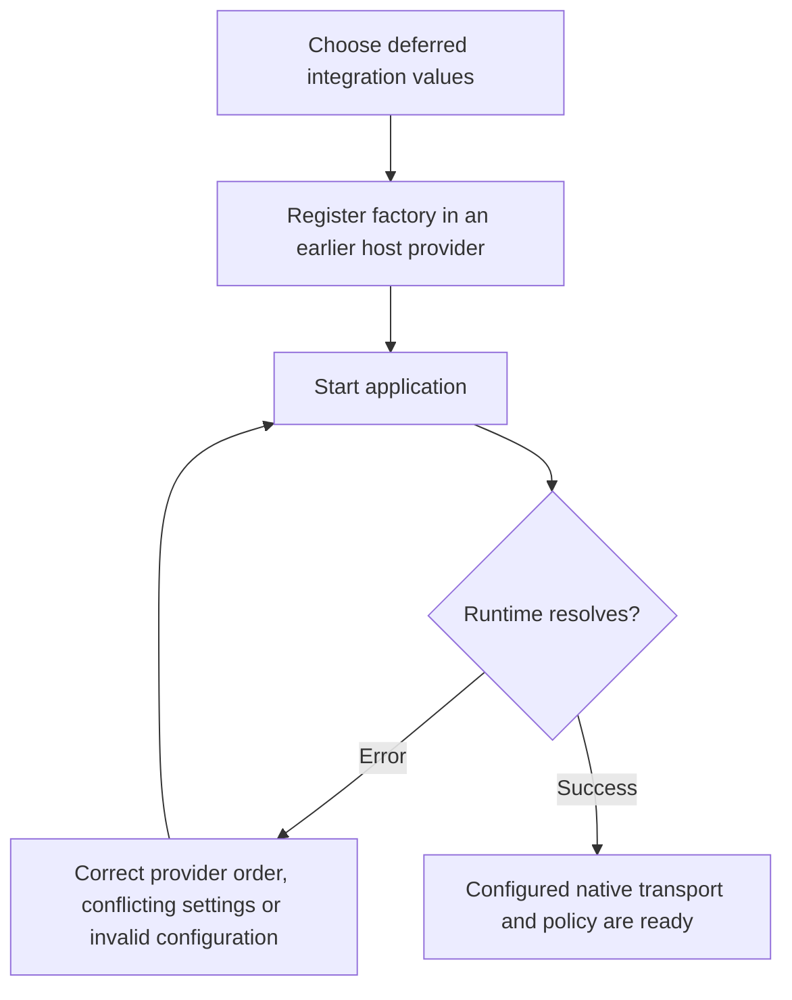
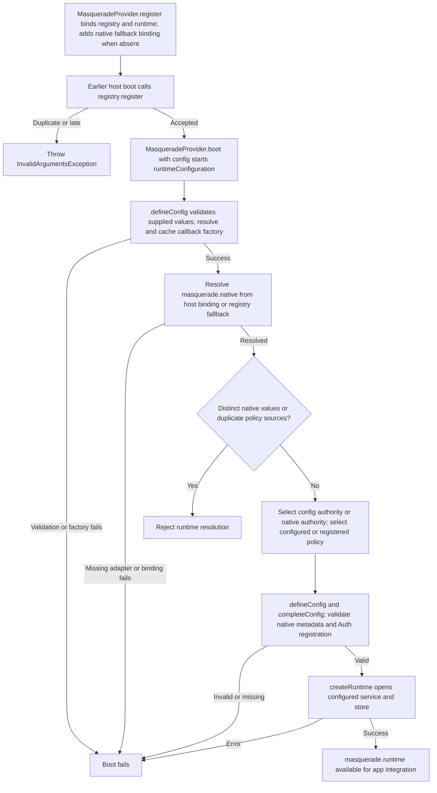

# US-SETUP-03 — Register integration callbacks during provider boot

As an application developer, I want to register the native adapter and policy from a host provider so that loading Masquerade configuration does not import my application services.

**Status:** Operator.
**Access:** Application developer who controls app config and provider order.
**Entry:** Register one factory on `masquerade.callbacks` in a host provider's `boot()`. List that provider before the package's `masquerade_provider`.
**Documentation:** [Registering callbacks from a provider](../../README.md#registering-callbacks-from-a-provider).
**Source:** [Registry](../../src/callback_registry.ts), [provider](../../providers/masquerade_provider.ts), [runtime construction](../../src/integration/runtime_factory.ts).
**Coverage:** [Callback registry integration](../../tests/callback_registry.spec.ts).

## Acceptance criteria

- `register(factory)` accepts a zero-argument factory which returns an object with optional `native` and `policy`, either synchronously or through a promise. The registry runs the factory when first needed and caches its promise. It refuses a second factory and registration after resolution has begun.
- The package uses an existing `masquerade.native` binding when supplied. Otherwise the package's binding reads `native` from the registry and errors if it is absent. If both supply native adapters, runtime validation rejects distinct adapter objects. Provide the native adapter through one path.
- The runtime uses the authority from `config/masquerade.ts` when supplied and otherwise uses the chosen native adapter's authority. An explicit authority must match the adapter's namespace and guard. For policy, provide either config or registered `policy`; the runtime rejects both and requires one.
- Loading the config validates supplied values and permits omitted authority and policy. Boot with Masquerade config resolves the completed runtime, including guard wiring and store construction. Calling standalone `createMasqueradeService` directly requires the completed config with both authority and policy.
- Registration does not authenticate a request. [US-SETUP-02](us-setup-02-select-credential-transport.md) describes live guard checks.

## User flow

## Code flow

Scope: provider and container resolution up to the configured service.

**Code references:** [Host and fallback bindings](../../providers/masquerade_provider.ts#L18), [factory resolution](../../src/callback_registry.ts#L11), [runtime validation](../../src/integration/runtime_factory.ts#L40), [runtime creation](../../src/integration/runtime_factory.ts#L157), [standalone service](../../src/service.ts#L60).
