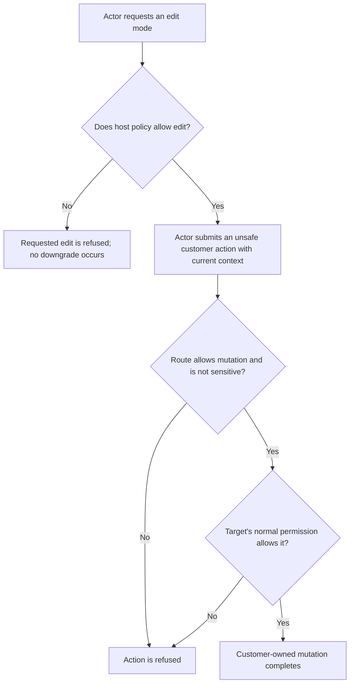
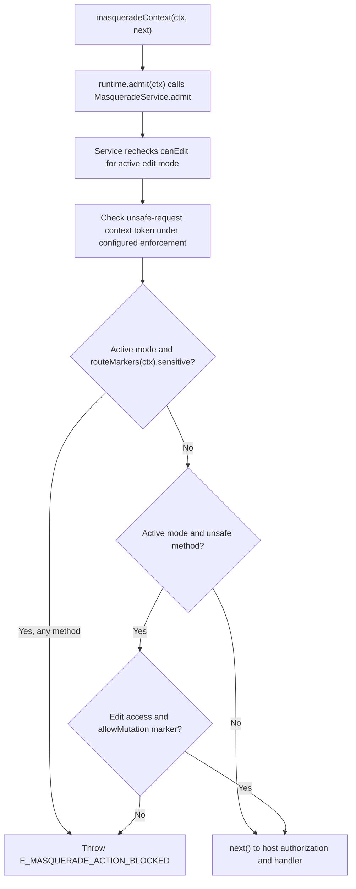

# US-ACTOR-03 — Make an allowed mutation during support

As a support actor, I want to make a customer-owned mutation only when I start an editable mode and the route opts in so that ordinary customer authorization remains in force.

**Status:** Current; source-reviewed admission and route-marker behavior.
**Access:** Active mode with `access: edit`, host `canEdit` returning literal `true`, an `allowMutation()` route marker, and the target account's normal permission.
**Entry:** Unsafe business route marked with `allowMutation()` and authenticated through the effective guard.
**Documentation:** [Use the effective customer identity](../../docs/guide/usage.md#use-the-effective-customer-identity), [view-only and edit policy](../../docs/guide/security.md#actor-target-and-scope).
**Source:** [route marker](../../src/integration/route_markers.ts), [request middleware](../../http/context_middleware.ts), [service admission](../../src/service.ts).
**Coverage:** [Context middleware tests](../../tests/http_context_middleware.spec.ts), [edit-mode tests](../../tests/core_authorization.spec.ts).

## Acceptance criteria

- View is selected explicitly or is the omitted `access` default; an edit request without approval is refused, never silently downgraded. An edit start requires `canEdit({ actor, target, reason, request })` to return exactly `true`; active edit admission rechecks `canEdit({ actor, target })`.
- For an active mode, `masqueradeContext` rejects sensitive routes for every HTTP method. On other unsafe requests it rejects access other than `edit` or a missing `allowMutation()` marker.
- `allowMutation()` only marks a route; it does not grant target-side permission. The handler's ordinary Bouncer or authorization check must still allow the effective target.
- Sensitive routes remain blocked even when a route also has `allowMutation()`.

## User flow

## Code flow

Scope: route policy middleware; the host handler performs its normal target authorization and persistence after `next()`.

**Code references:** [allowMutation and routeMarkers](../../src/integration/route_markers.ts), [masqueradeContext](../../http/context_middleware.ts), [MasqueradeService.admit](../../src/service.ts), [security rules](../../docs/guide/security.md#actor-target-and-scope).
