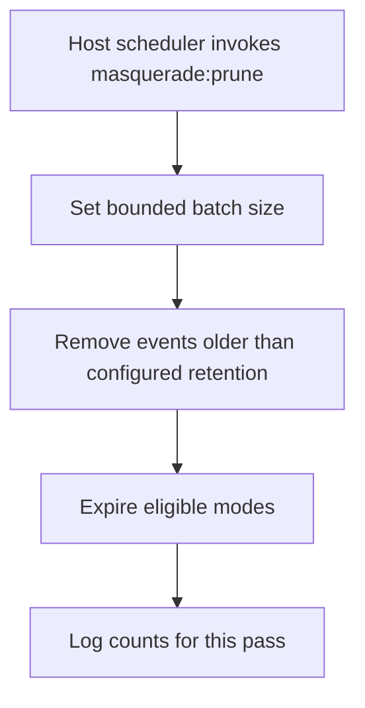
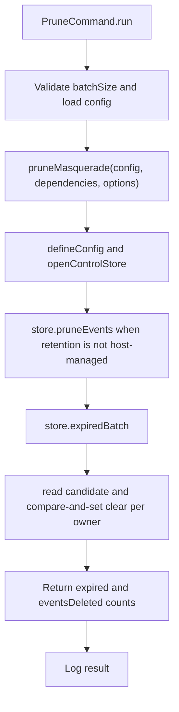

# US-OPS-03 — Expire inactive modes and prune retained events

As a host operator, I want a scheduled bounded cleanup pass so that expired modes and events beyond the configured retention are removed without adding a package-owned background worker.

**Status:** Operator; Ace housekeeping command is available when configured.
**Access:** Host operator with scheduler and control-store access.
**Entry:** Schedule `node ace masquerade:prune [--batch-size n]`.
**Documentation:** [Schedule recurring cleanup](../../docs/guide/operations.md#schedule-recurring-work), [retention scope](../../docs/guide/operations.md#event-retention-and-store-scope).
**Source:** [PruneCommand](../../commands/prune.ts), [pruneMasquerade](../../src/prune.ts).
**Coverage:** [Prune command tests](../../tests/prune_command.spec.ts), [prune service tests](../../tests/prune.spec.ts).

## Acceptance criteria

| Option         | Control     | Required/default/conditions                  |
| -------------- | ----------- | -------------------------------------------- |
| `--batch-size` | Number flag | Defaults to 100; safe integer from 1 to 1000 |

- One invocation prunes eligible events first, then processes one bounded batch of expired mode rows; compare-and-set protects mode transitions.
- Configured event retention applies to every namespace visible through the store; use a scoped store for different retention periods. `host-managed` event retention is not pruned by this command.
- No background worker starts automatically; the host scheduler must invoke this command.

## User flow

## Code flow

Scope: one command invocation; host recurrence and alerting remain outside the package.

**Code references:** [PruneCommand](../../commands/prune.ts), [pruneMasquerade](../../src/prune.ts), [schedule guide](../../docs/guide/operations.md#schedule-recurring-work).
