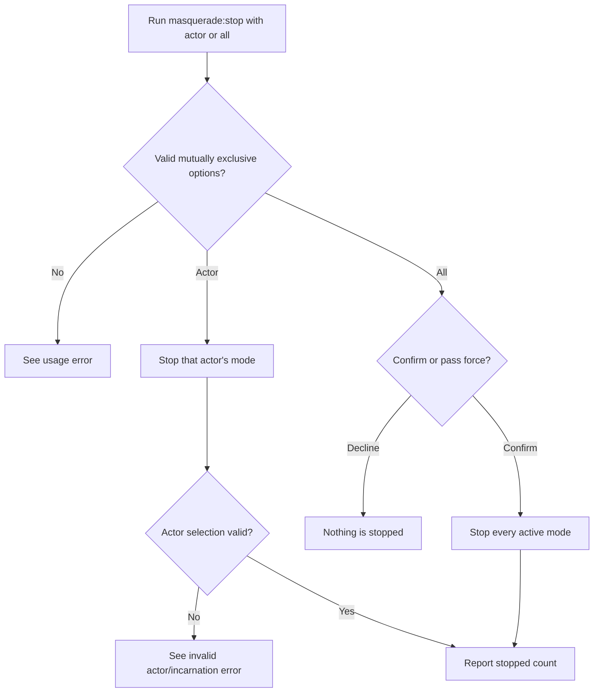
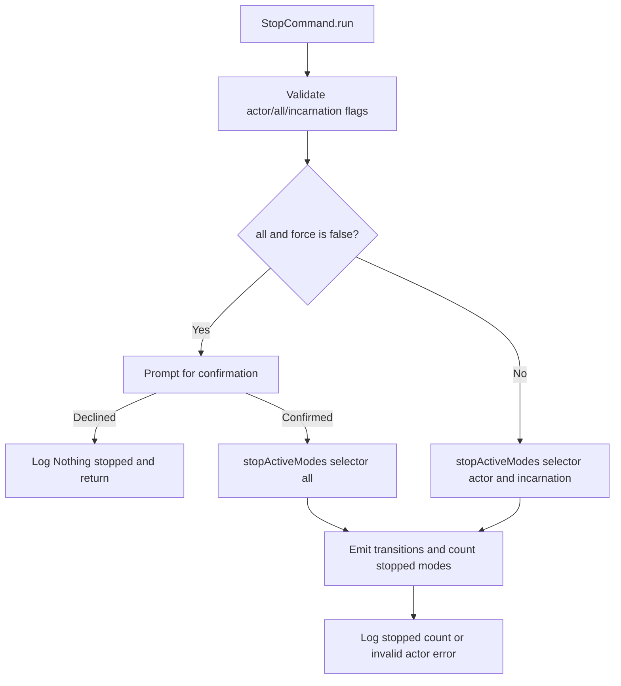

# US-OPS-04 — Revoke one or all active support modes

As a host operator, I want to stop a selected actor's mode or confirm stopping all modes so that I can revoke active support access during operations or incident response.

**Status:** Operator; Ace stop command is available when configured.
**Access:** Host operator with server command access and control-store access.
**Entry:** `node ace masquerade:stop --actor id [--incarnation value]` or `node ace masquerade:stop --all [--force]`.
**Documentation:** [See and end active modes](../../docs/guide/operations.md#see-and-end-active-modes).
**Source:** [StopCommand](../../commands/stop.ts), [stopActiveModes](../../src/stop_modes.ts).
**Coverage:** [Stop command tests](../../tests/mode_commands.spec.ts), [stop mode tests](../../tests/stop_modes.spec.ts).

## Acceptance criteria

| Option          | Control      | Required/default/conditions                                           |
| --------------- | ------------ | --------------------------------------------------------------------- |
| `--actor`       | String flag  | Required unless `--all`; actor account ID                             |
| `--incarnation` | String flag  | Optional with `--actor`; disambiguates a deleted/reused actor account |
| `--all`         | Boolean flag | Selects every active mode; mutually exclusive with actor/incarnation  |
| `--force`       | Boolean flag | Skips confirmation for `--all` only                                   |

- Exactly one of `--actor` or `--all` is required; incarnation is allowed only with actor.
- `--all` prompts “End every active masquerade mode?” unless `--force`; declining reports “Nothing stopped.”
- Unknown actor/incarnation fails with a nonzero result. Successful operation reports number of modes stopped.

## User flow

## Code flow

Scope: CLI operator request through `stopActiveModes` and per-owner state transitions.

**Code references:** [StopCommand](../../commands/stop.ts), [stopActiveModes](../../src/stop_modes.ts), [operator guide](../../docs/guide/operations.md#see-and-end-active-modes).
