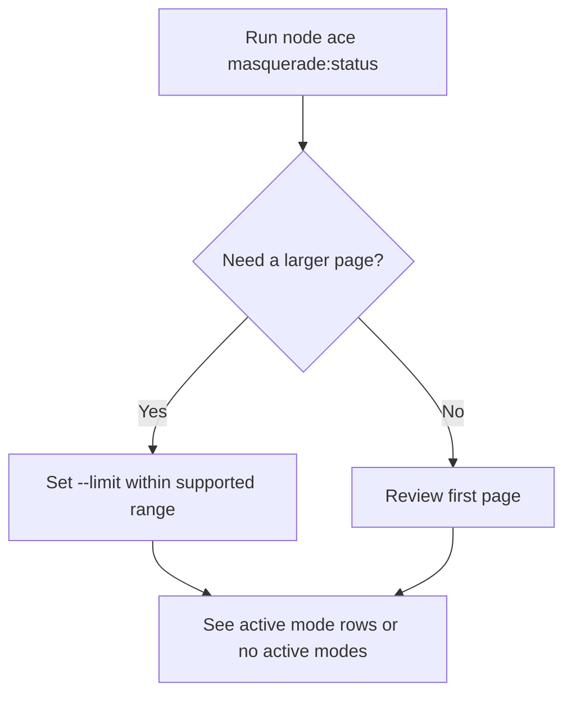
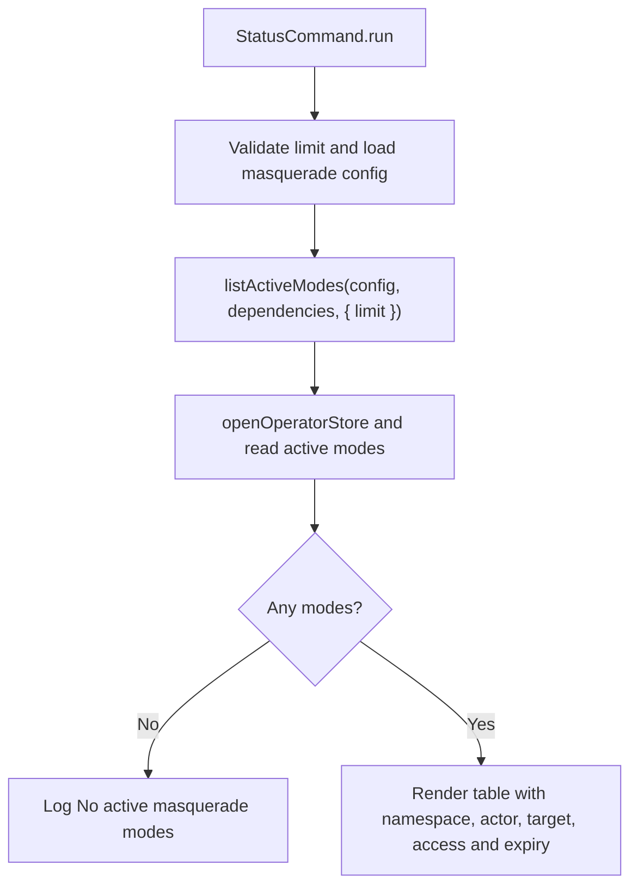

# US-OPS-01 — Inspect active support modes

As a Masquerade operator, I want to list active support modes so that I can see which actors are viewing which targets and when each mode expires.

**Status:** Operator; Ace command is available when configured.
**Access:** Host operator with command access and configured control store.
**Entry:** `node ace masquerade:status [--limit n]`.
**Documentation:** [See active modes](../../docs/guide/operations.md#see-and-end-active-modes).
**Source:** [StatusCommand](../../commands/status.ts), [listActiveModes](../../src/active_modes.ts).
**Coverage:** [Mode command tests](../../tests/mode_commands.spec.ts), [active mode tests](../../tests/active_modes.spec.ts).

## Acceptance criteria

| Option    | Control     | Required/default/conditions                                                                              |
| --------- | ----------- | -------------------------------------------------------------------------------------------------------- |
| `--limit` | Number flag | Defaults to 50 (`DEFAULT_ACTIVE_MODE_LIMIT`); safe integer from 1 through 1000 (`MAX_ACTIVE_MODE_LIMIT`) |

- The command renders namespace, actor, actor incarnation, target, access and expiry for each returned mode.
- When no modes are active it reports that state; it does not alter or expire a mode.
- Invalid limits or missing Masquerade configuration fail rather than silently returning an empty result.

## User flow

## Code flow

Scope: Ace command through the read-only active-mode store query.

**Code references:** [StatusCommand](../../commands/status.ts), [active mode query](../../src/active_modes.ts), [operations guide](../../docs/guide/operations.md#see-and-end-active-modes).
