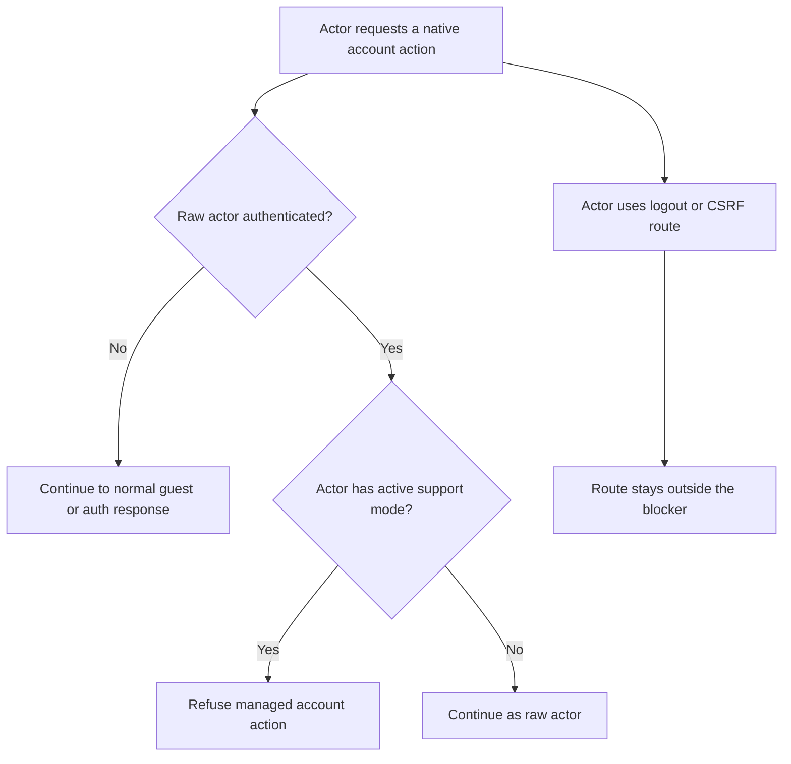
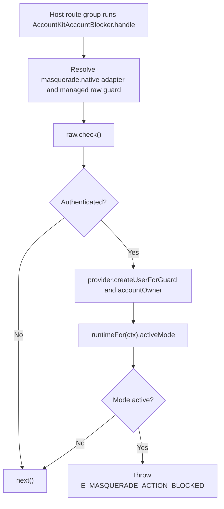

# US-ACCOUNT-01 — Keep native account operations on the actor account

As an application developer integrating Account Kit, I want account-management routes to use the raw actor guard and block managed actions during an active mode so that support mode cannot change the support operator's own account unintentionally.

**Status:** Current when the host opts into the Account Kit blocker.
**Access:** Host route configuration; blocker checks the authenticated raw account and its active mode.
**Entry:** Apply `AccountKitAccountBlocker` and raw guard to native account routes; keep logout and CSRF outside the blocked group.
**Documentation:** [Account Kit integration](../../docs/guide/account-kit.md#block-host-owned-account-routes), [security boundary](../../docs/guide/security.md#account-kit-admission-and-managed-actions).
**Source:** [AccountKitAccountBlocker](../../account_kit/middleware.ts), [Account Kit example routes](../../examples/with_account_kit/hypermedia/start/routes.ts).
**Coverage:** [Blocker tests](../../tests/account_kit_account_blocker.spec.ts), [Account Kit route tests](../../examples/account-kit/tests/functional/account_kit_routes.spec.ts).

## Acceptance criteria

- Host applies the blocker to account registration/management operations and authenticates them with the raw guard, not the effective target identity.
- When unauthenticated, the blocker continues to the route's normal guest/auth handling. When authenticated and the actor has an active mode, it throws `E_MASQUERADE_ACTION_BLOCKED` with `blockedBy: sensitive`.
- Logout and CSRF routes remain outside the blocked group so the actor can end their native session.
- The package cannot enforce this boundary on host routes where the middleware/guard is omitted; `masquerade:routes` reports coverage for operator review.

## User flow

## Code flow

Scope: opt-in middleware boundary on host-managed Account Kit routes.

**Code references:** [blocker](../../account_kit/middleware.ts), [example route grouping](../../examples/with_account_kit/hypermedia/start/routes.ts), [integration guide](../../docs/guide/account-kit.md#block-host-owned-account-routes).
