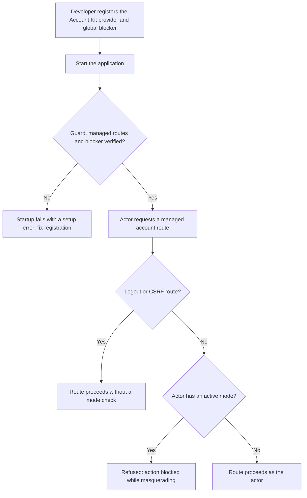
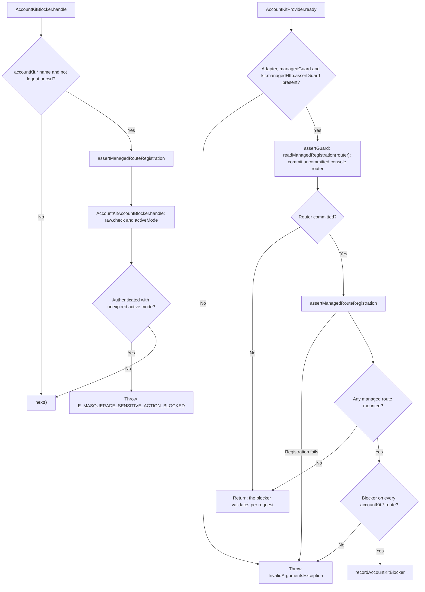

# US-ACCOUNT-02 — Install the Account Kit provider and global blocker

As an application developer integrating Account Kit, I want to register the Account Kit provider and global blocker so that every managed `accountKit.*` route is blocked while the actor has an active mode and a mismatched guard or route registration fails at startup.

**Status:** Current when the host registers both; source-reviewed, not runtime-tested.
**Access:** Application developer with permission to edit `adonisrc.ts` providers and `start/kernel.ts` router middleware.
**Entry:** Register `@kevinjohn/adonisjs-masquerade/account-kit/provider` as a provider and the default export of `@kevinjohn/adonisjs-masquerade/account-kit/middleware` in `router.use([...])`, after `initialize_auth_middleware`.
**Documentation:** [Install the provider and blocker](../../docs/guide/account-kit.md#install-the-provider-and-blocker).
**Source:** [AccountKitBlocker](../../account_kit/middleware.ts), [AccountKitProvider](../../account_kit/provider.ts).
**Coverage:** [Blocker tests](../../tests/account_kit_blocker.spec.ts), [provider tests](../../tests/account_kit_provider.spec.ts).

## Acceptance criteria

- The provider's `ready` hook requires an Account Kit native adapter with a managed guard and a managed HTTP service, then asserts the managed guard. A missing piece throws `InvalidArgumentsException` and startup fails.
- Once the router is committed, the provider checks the registered `accountKit.*` routes against Account Kit's route registration, and fails startup with `Account Kit blocker middleware is missing` when any mounted managed route lacks the blocker. A console lifecycle commits the router itself first; other lifecycles do not. Route registration is asserted first: registered `accountKit.*` routes that are not mounted fail startup with an `is not mounted` error. With no mounted `accountKit.*` route, the blocker-installation check is skipped.
- On a request, the global blocker passes any route that is not named `accountKit.*`, and passes `accountKit.account.logout` and `accountKit.auth.csrf` without a store read. These two stay available so the actor can end the session or fetch a CSRF token to stop the mode.
- For other managed routes it re-validates route registration, then applies the raw-actor check: unauthenticated requests continue; an authenticated actor with an unexpired active mode receives `E_MASQUERADE_SENSITIVE_ACTION_BLOCKED` with `blockedBy: 'sensitive'` before the handler; an adapter wiring fault returns `E_MASQUERADE_UNAVAILABLE` and a failed store read returns `E_MASQUERADE_STORE_READ_FAILED`. An expired stored row is treated as inactive without changing it.
- Once verified, `masquerade:routes` lists managed routes as blocked while active (logout and CSRF as exempt); otherwise they stay `UNCLASSIFIED`.
- Host-owned account routes are not covered by this global blocker; see US-ACCOUNT-01.

## User flow

## Code flow

Scope: provider startup validation and the global blocker's per-request branch; host handler behaviour is outside this story.

**Code references:** [provider](../../account_kit/provider.ts), [global blocker](../../account_kit/middleware.ts), [installation guide](../../docs/guide/account-kit.md#install-the-provider-and-blocker), [route report classification](../../commands/routes.ts).
