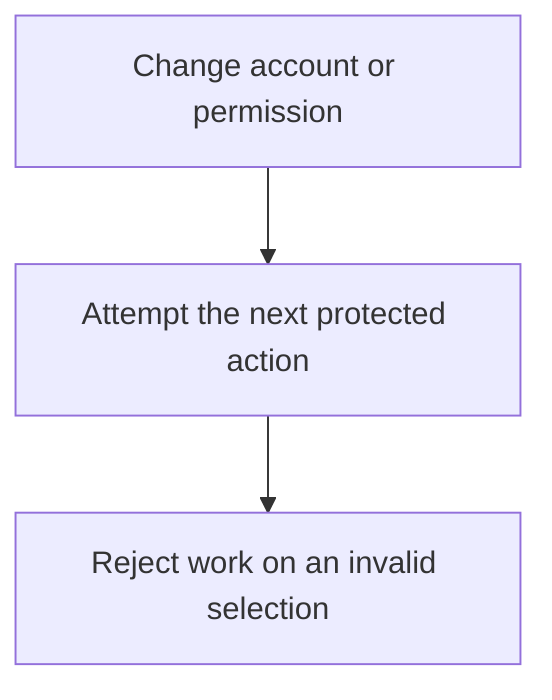
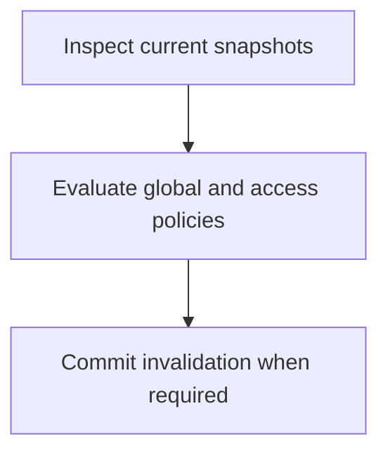

# US-ACCOUNT-03 — End support when an account or its permissions change

As a host policy owner, I want to invalidate a support mode when either account ceases to qualify so that an old selection cannot authorise fresh business work.

**Status:** Current under the stated integration.
**Access:** Host policy owner
**Entry:** Native or custom authority inspectAccount and active business admission.
**Documentation:** [Custom authorities](../../docs/guide/custom-authorities.md).
**Source:** [Inspection contract](../../src/types.ts), [Service](../../src/service.ts), [Stamp selector](../../native/stamp_from.ts).
**Coverage:** [Admission](../../tests/core_admission.spec.ts), [Failure handling](../../tests/core_failures.spec.ts), [Stamp selector tests](../../tests/stamp_from.spec.ts).

## Acceptance criteria

- Supply the current subject, incarnation, active flag and security stamp in the inspection snapshot. Native adapters may use `stampFrom` with a non-empty selection of stable fields. Core uses the inspected stamp.
- A changed stamp or incarnation, inactive or missing account, revoked global permission, or revoked edit permission for an edit mode prevents the triggering request and clears the selection upon a successful transition. View admission does not call canEdit.
- An authority or policy exception returns unavailable and preserves the selection. A credential or request-local denial also prevents the request while preserving the selection. Repeated admission in one request retains its first decision.

## User flow

## Code flow

