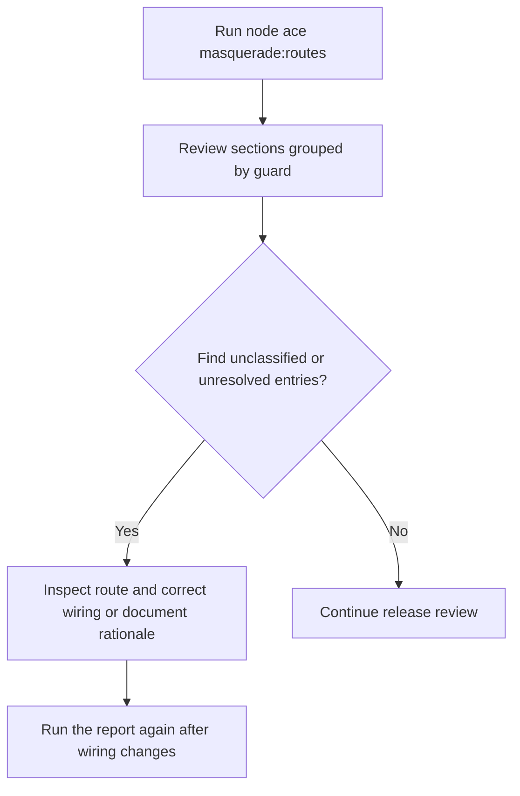
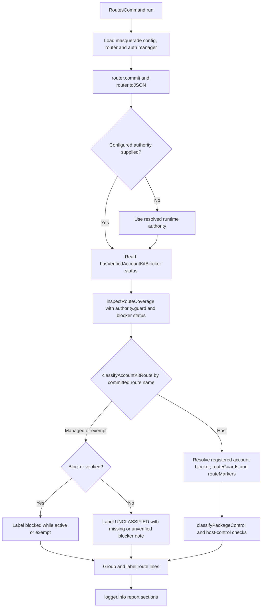

# US-OPS-02 — Review route coverage for Masquerade

As an application maintainer, I want a route coverage report so that I can find control routes, effective-guard business routes, raw-guard routes, markers and unresolved handlers before enabling support access.

**Status:** Operator; Ace report is available when app config and route registration load.
**Access:** Application maintainer with command access.
**Entry:** `node ace masquerade:routes`.
**Documentation:** [Route report](../../docs/guide/route-report.md).
**Source:** [RoutesCommand and inspectRouteCoverage](../../commands/routes.ts).
**Coverage:** [Routes command tests](../../tests/routes_command.spec.ts), [managed route report and blocker agreement](../../tests/account_kit_provider.spec.ts), [route metadata tests](../../tests/route_metadata.spec.ts).

## Acceptance criteria

- The command requires `config/masquerade`, resolves effective and raw guard names, commits the router, and reports each registered route's methods and pattern. Host-owned routes include guard categories and recognised markers. Managed `accountKit.*` routes instead report their managed or unclassified category and READ/MUTATION label without inspecting guards or route markers.
- Package control handlers are identified by controller/method; unresolved handlers, possible name-inferred controls, unprotected routes, unsupported mixed guards and distinct effective transports remain visible for human review. Supported host-owned account blocker references receive their own label.
- The global blocker and report share the `accountKit.*` route-name rule. With verified registration, logout and CSRF are labelled `Account Kit managed (exempt)` and ordinary managed routes are labelled `Account Kit managed (blocked while active)`. Without verification, every managed route is `UNCLASSIFIED` with a missing or unverified blocker note.
- The report is diagnostic only. It does not change route definitions or enforce authorisation.

## User flow

## Code flow

Scope: committed route metadata analysis; report output does not enforce route behaviour.

**Code references:** [RoutesCommand and report](../../commands/routes.ts), [shared route classification](../../src/integration/account_kit_route_classification.ts), [global blocker](../../src/account_kit/middleware.ts), [provider verification](../../providers/account_kit_provider.ts), [route marker resolver](../../src/integration/route_markers.ts).
