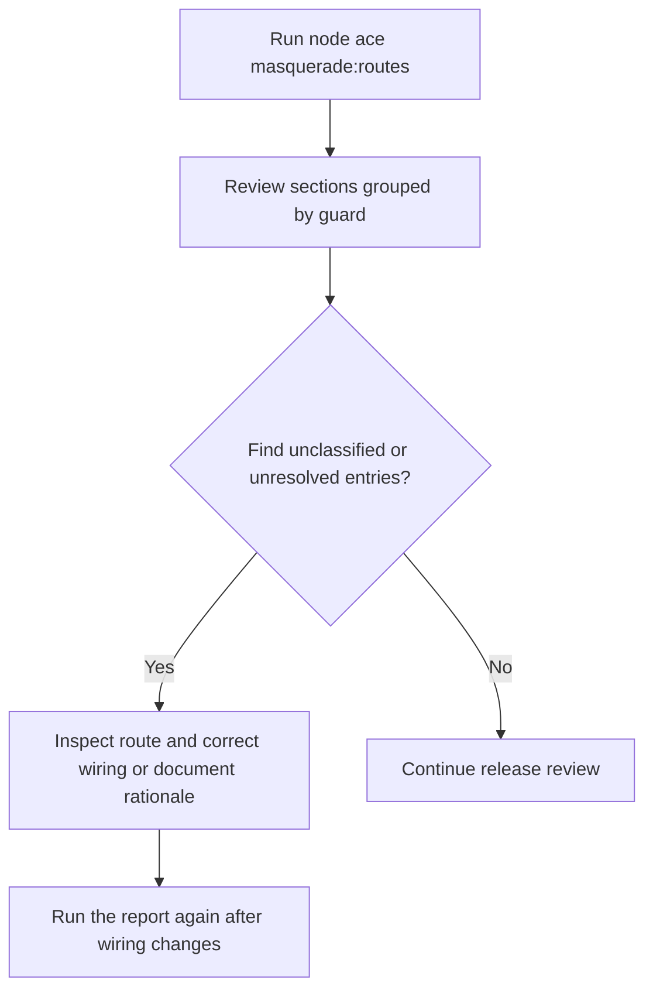
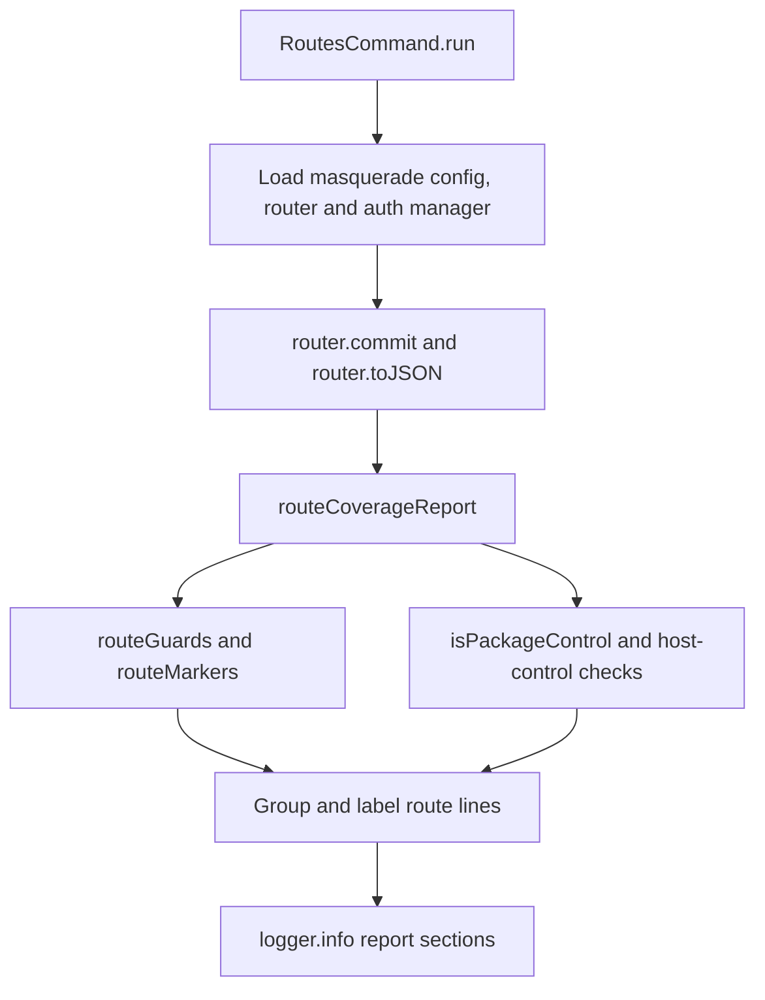

# US-OPS-02 — Review route coverage for Masquerade

As an application maintainer, I want a route coverage report so that I can find control routes, effective-guard business routes, raw-guard routes, markers and unresolved handlers before enabling support access.

**Status:** Operator; Ace report is available when app config and route registration load.
**Access:** Application maintainer with command access.
**Entry:** `node ace masquerade:routes`.
**Documentation:** [Route report](../../docs/guide/route-report.md).
**Source:** [RoutesCommand and routeCoverageReport](../../commands/routes.ts).
**Coverage:** [Routes command tests](../../tests/routes_command.spec.ts), [route metadata tests](../../tests/route_metadata.spec.ts).

## Acceptance criteria

- The command requires `config/masquerade`, resolves effective and raw guard names, commits the router, and reports each registered route's methods, pattern, guard category and recognized markers.
- Package control handlers are identified by controller/method; unresolved handlers, possible name-inferred controls, unprotected routes and unsupported mixed guards remain visible for human review.
- The report is diagnostic only. It does not change route definitions or enforce authorization.

## User flow

## Code flow

Scope: committed route metadata analysis; report output does not enforce route behavior.

**Code references:** [RoutesCommand and report](../../commands/routes.ts), [route marker resolver](../../src/integration/route_markers.ts), [route report guide](../../docs/guide/route-report.md).
