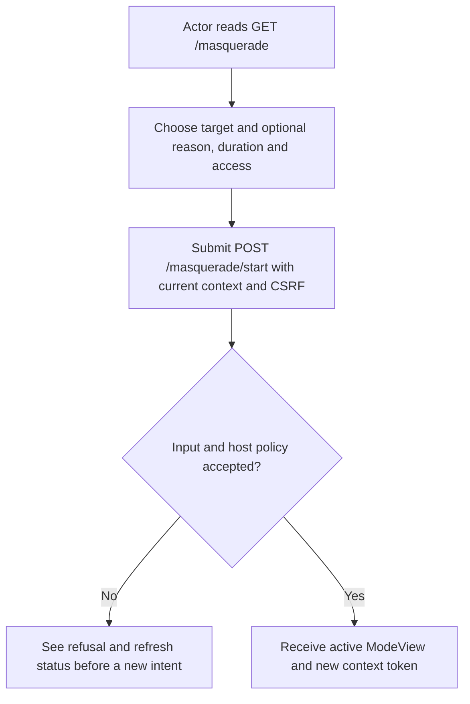
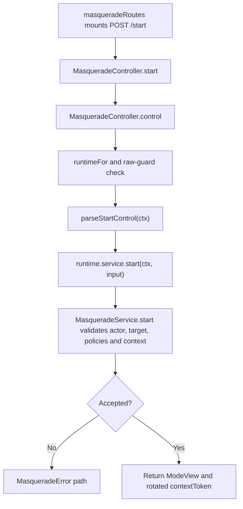

# US-ACTOR-01 — Start a support mode for an eligible target

As a signed-in actor, I want to start a temporary support mode for an eligible target so that I can inspect the target's account using a request-scoped effective identity.

**Status:** Current; source-reviewed HTTP control.
**Access:** Actor authenticated by the configured raw control guard; host `canMasquerade` policy must approve actor and target. For API access tokens, the token also needs the configured `masquerade` ability.
**Entry:** Read `GET /masquerade`, then submit `POST /masquerade/start`, mounted by `masqueradeRoutes()`.
**Documentation:** [Read status and start](../../docs/guide/usage.md#read-status-and-start).
**Source:** [MasqueradeController.start](../../http/controllers.ts), [start input parser](../../http/control_input.ts), [service start](../../src/service.ts).
**Coverage:** [HTTP controller tests](../../tests/http_controllers.spec.ts), [core authorization tests](../../tests/core_authorization.spec.ts).

## Acceptance criteria

| Field or header                               | Control                               | Required/default/conditions                                                                                                                                                                                  |
| --------------------------------------------- | ------------------------------------- | ------------------------------------------------------------------------------------------------------------------------------------------------------------------------------------------------------------ |
| `targetId`                                    | JSON/form value                       | Required; string or safe integer, canonicalized to string; nonempty, at most 255 UTF-8 bytes, well-formed with no control characters, and cannot equal actor ID                                              |
| `reason`                                      | JSON/form value                       | Optional by default: absent, null or blank stores null; when supplied nonblank, trim/normalize; 1–500 Unicode code points and at most 2,000 UTF-8 bytes                                                      |
| `durationSeconds`                             | JSON number or URL-form number string | Optional; omitted or blank URL-form field uses configured default (package default 900); safe integer 60 through configured maximum (default 3600). URL-form strings must be canonical; JSON null is invalid |
| `access`                                      | JSON/form choice                      | Optional; `view` default or `edit`; edit requires host `canEdit` to return literal `true`                                                                                                                    |
| `_masqueradeContext` / `X-Masquerade-Context` | Hidden form field or request header   | Current token from status; if both are sent they must agree; cookie-authenticated writes also require Shield CSRF                                                                                            |

- The body is at most 8 KiB and must be JSON or URL-encoded form data; multipart and unknown fields are refused.
- If reason is configured as required, absent, null or blank reason is refused. A successful start stores one active mode and returns its `ModeView` with a fresh context token.
- Invalid input, stale context, a failed `canMasquerade` policy or a failed edit policy refuses start; the actor remains authenticated as themselves.
- A bearer token also needs the configured `masquerade` ability before status or start reads or changes mode state.

## User flow

## Code flow

Scope: raw-guarded control handler through the service start transition and response.

**Code references:** [route mount](../../http/control_routes.ts), [controller](../../http/controllers.ts), [parser](../../http/control_input.ts), [service start](../../src/service.ts), [start guide](../../docs/guide/usage.md#read-status-and-start).
