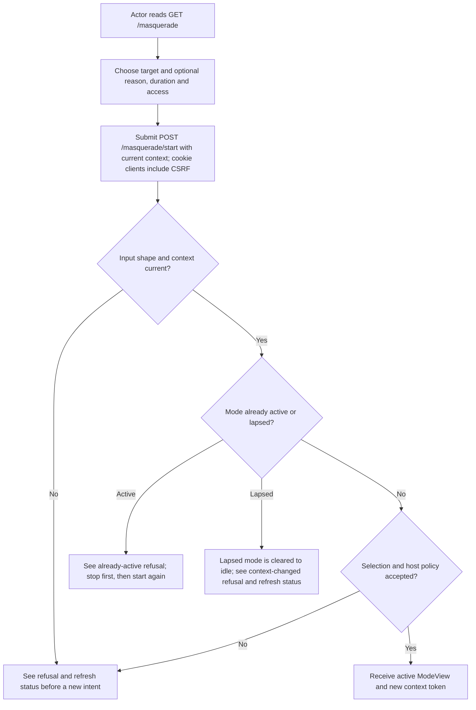
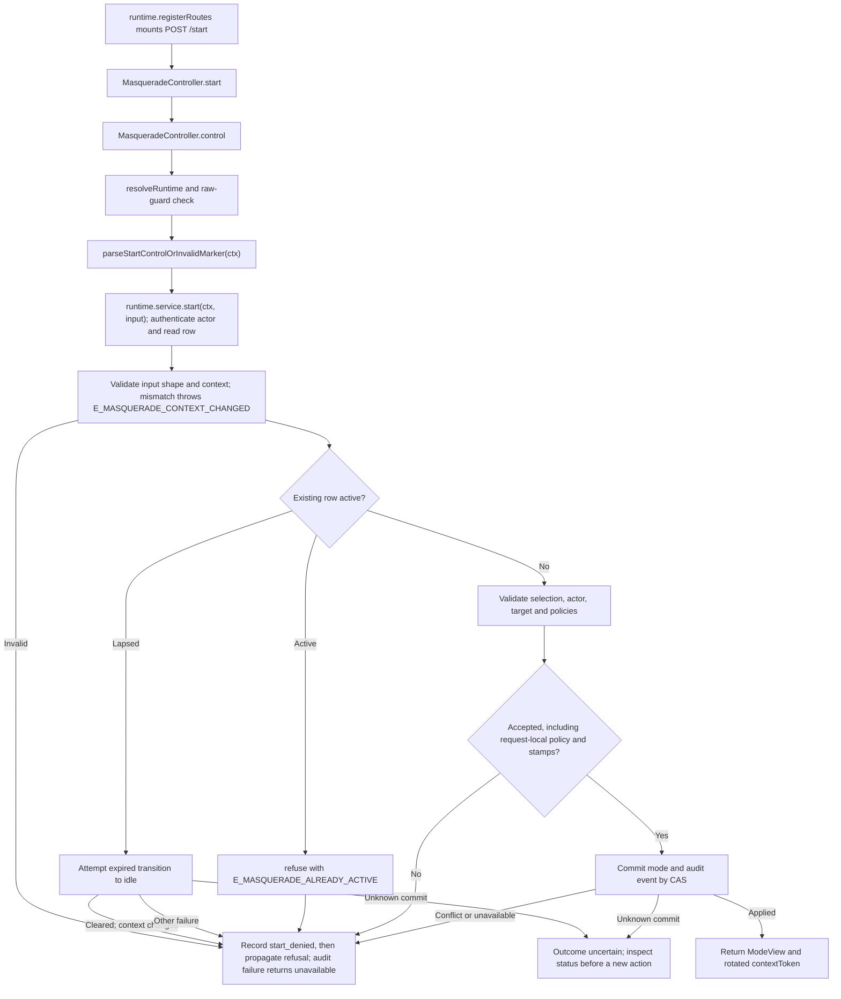

# US-ACTOR-01 — Start a support mode for an eligible target

As a signed-in actor, I want to start a temporary support mode for an eligible target so that I can inspect the target's account using a request-scoped effective identity.

**Status:** Current; source-reviewed HTTP control.
**Access:** Actor authenticated by the configured raw control guard; host `canMasquerade` callback must approve actor and target. For API access tokens, the token also needs the configured `masquerade` ability.
**Entry:** Read `GET /masquerade`, then submit `POST /masquerade/start`, mounted by `runtime.registerRoutes()`.
**Documentation:** [Read status and start](../../docs/guide/usage.md#read-status-and-start).
**Source:** [MasqueradeController.start](../../src/http/masquerade_controller.ts), [start input parser](../../src/http/control_input.ts), [service start](../../src/service.ts).
**Coverage:** [HTTP controller tests](../../tests/http_controllers.spec.ts), [core authorisation tests](../../tests/core_authorization.spec.ts).

## Acceptance criteria

| Field or header                               | Control                               | Required/default/conditions                                                                                                                                                                                  |
| --------------------------------------------- | ------------------------------------- | ------------------------------------------------------------------------------------------------------------------------------------------------------------------------------------------------------------ |
| `targetId`                                    | JSON/form value                       | Required; string or safe integer, canonicalised to string; nonempty, at most 255 UTF-8 bytes, well-formed with no control characters, and cannot equal actor ID                                              |
| `reason`                                      | JSON/form value                       | Optional by default: absent, null or blank stores null; when supplied nonblank, trim/normalise; 1–500 Unicode code points and at most 2,000 UTF-8 bytes                                                      |
| `durationSeconds`                             | JSON number or URL-form number string | Optional; omitted or blank URL-form field uses configured default (package default 900); safe integer 60 through configured maximum (default 3600). URL-form strings must be canonical; JSON null is invalid |
| `access`                                      | JSON/form choice                      | Optional; omitted or blank URL-form field defaults to `view`; `edit` requires host `canEdit` to return literal `true`; JSON null invalid                                                                     |
| `_masqueradeContext` / `X-Masquerade-Context` | Hidden form field or request header   | Current token from status; if both are sent they must agree; cookie-authenticated writes also require Shield CSRF                                                                                            |

- The body is at most 8 KiB and must be JSON or URL-encoded form data; multipart and unknown fields are refused.
- If reason is configured as required, absent, null or blank reason is refused. A nonblank reason must also be well-formed and free of disallowed control and invisible formatting characters. A successful start stores one active mode and returns its `ModeView` with a fresh context token.
- Input shape and the context token are checked first, so a stale token is refused with `E_MASQUERADE_CONTEXT_CHANGED` even while a mode is active. Invalid input, stale context, a failed `canMasquerade` callback or a failed `canEdit` callback refuses start; the actor remains authenticated as themselves.
- Starting while a mode is already active is refused with `E_MASQUERADE_ALREADY_ACTIVE`; the active mode is not replaced or extended. Starting from an active row whose deadline has passed clears it to idle and then refuses with `E_MASQUERADE_CONTEXT_CHANGED`; no new mode starts from it.
- Start calls `canMasquerade` and, for edit, `canEdit` with `{ actor, target, request, reason? }`, then optional `canUseRequest` with `{ actor, target, request }`. Only literal `true` permits each configured check. Later admission rechecks global callbacks with actor and target only; it does not pass the original request or reason.
- A bearer token also needs the configured `masquerade` ability before status or start reads or changes mode state. An unknown commit returns unavailable without a denial event; inspect authoritative status before a new action.

## Raw controls and the optional HTML adapter

The JSON controller requires a raw guard for both start and stop. It forwards invalid control shapes to the service so authenticated, admitted control attempts reach the same denial audit boundary. Authentication, Shield and limiter failures retain their host handling.

The generated form controller uses the shared transition path for an explicit HTML preference. It accepts URL-encoded forms, flashes the action on success or the stable Masquerade code on failure, then redirects to the host-selected path. Other exceptions propagate. Requests preferring JSON delegate to the package controller. Both response paths prevent caching.

**Source:** [control parser](../../src/http/control_input.ts), [controller](../../src/http/masquerade_controller.ts), [example form controller](../../examples/native-session/app/controllers/masquerade_form_controller.ts). **Coverage:** [controller tests](../../tests/http_controllers.spec.ts), [form adapter tests](../../tests/form_controller_stub.spec.ts).

## User flow

## Code flow

Scope: raw-guarded control handler through the service start transition and response.

**Code references:** [route mount](../../src/http/control_routes.ts), [controller](../../src/http/masquerade_controller.ts), [parser](../../src/http/control_input.ts), [service start and active-row refusals](../../src/service.ts), [start guide](../../docs/guide/usage.md#read-status-and-start).
