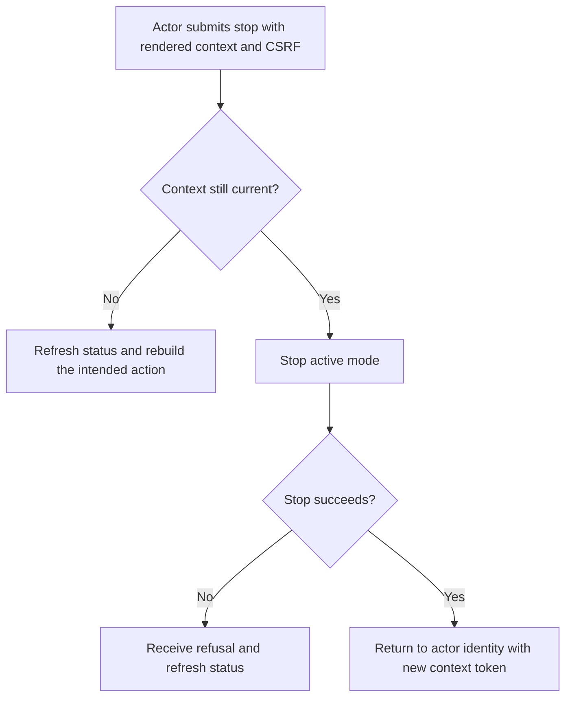
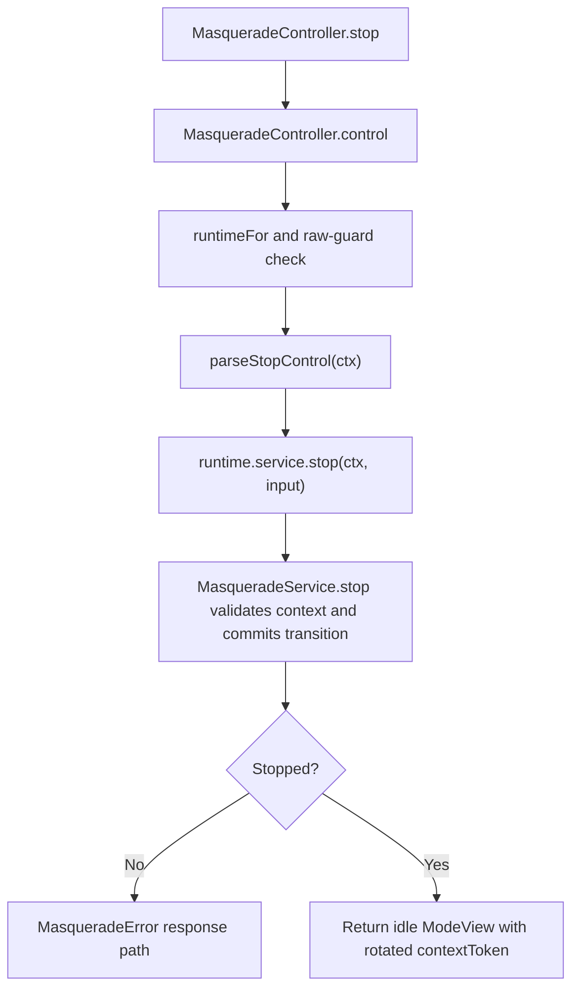

# US-ACTOR-04 — Stop the current support mode

As a signed-in actor, I want to stop my active support mode with the current context token so that subsequent business requests use my own account identity.

**Status:** Current; source-reviewed HTTP control.
**Access:** Actor authenticated by the configured raw control guard; this story follows an active mode. An authorized idle/absent stop is also accepted as a no-op with unchanged context. API tokens also need the configured `masquerade` ability.
**Entry:** `POST /masquerade/stop` mounted by `masqueradeRoutes()`.
**Documentation:** [Stop with the refreshed token](../../docs/guide/usage.md#stop-with-the-refreshed-token).
**Source:** [MasqueradeController.stop](../../http/controllers.ts), [parseStopControl](../../http/control_input.ts), [MasqueradeService.stop](../../src/service.ts).
**Coverage:** [HTTP controller tests](../../tests/http_controllers.spec.ts), [service transition tests](../../tests/mode_transition.spec.ts).

## Acceptance criteria

| Field or header                               | Control                             | Required/default/conditions                                                      |
| --------------------------------------------- | ----------------------------------- | -------------------------------------------------------------------------------- |
| `_masqueradeContext` / `X-Masquerade-Context` | Hidden form field or request header | Must match current context; if both are present they must match                  |
| Shield CSRF token                             | Host field/header                   | Required for cookie-authenticated writes; Masquerade context does not replace it |

- For the active-mode scenario, a successful stop clears the actor's active mode and returns an idle `ModeView` with a new context token.
- Missing or stale context is rejected by context enforcement. A concurrent or lost response requires reading `GET /masquerade`; clients must not automatically replay the old stop.
- Token transport also requires the configured `masquerade` ability; the ability does not grant edit access or bypass host policy.

## User flow

## Code flow

Scope: active-mode scenario through the raw-guarded stop control, service transition and response; idle/absent success is a no-op.

**Code references:** [controller](../../http/controllers.ts), [stop parser](../../http/control_input.ts), [service stop](../../src/service.ts), [stop guide](../../docs/guide/usage.md#stop-with-the-refreshed-token).
