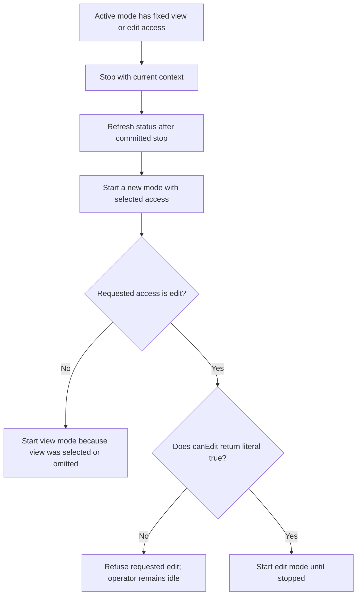
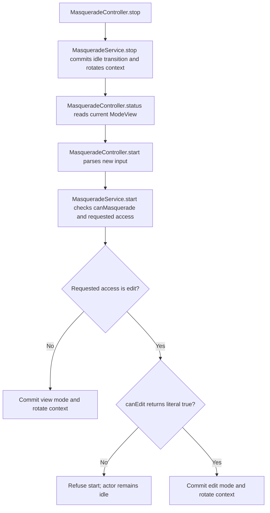

# US-ACTOR-05 — Change the access level of a support mode

As a signed-in actor, I want to restart my support mode with a different access level so that the mode remains fixed at the level deliberately chosen for its lifetime.

**Status:** Current; source-reviewed transition behavior.
**Access:** Actor authenticated by the raw control guard; requesting edit still requires host `canEdit` approval.
**Entry:** Stop the current mode, refresh `GET /masquerade`, then start again with `access: view` or `access: edit`.
**Documentation:** [Access level and defaults](../../docs/guide/usage.md#read-status-and-start), [accepted access contract](../../docs/maintainers/design/spec-masquerade.md#14-view-only-default-and-per-start-edit-access-accepted-22-october-2026).
**Source:** [start/stop service transitions](../../src/service.ts), [control input](../../http/control_input.ts).
**Coverage:** [Core authorization tests](../../tests/core_authorization.spec.ts), [mode transition tests](../../tests/mode_transition.spec.ts).

## Acceptance criteria

| Field                 | Control                                        | Required/default/conditions                                        |
| --------------------- | ---------------------------------------------- | ------------------------------------------------------------------ |
| `access`              | Start request choice                           | Optional; `view` default or `edit`; no in-place mode change exists |
| Current context token | `_masqueradeContext` or `X-Masquerade-Context` | Read new status after stop and use its rotated token on restart    |

- Access level remains fixed until the mode stops. To change it, stop then start a new mode; the target and policy are re-evaluated.
- `edit` is accepted only when `canEdit` returns literal `true`; absent, false, non-boolean or throwing policy does not grant edit.
- A stale context or failed restart policy is refused; an old action must not be replayed with a freshly fetched token.

## User flow

## Code flow

Scope: separate stop/start transitions; the service exposes no in-place access mutation.

**Code references:** [service start/stop](../../src/service.ts), [control parser](../../http/control_input.ts), [access contract](../../docs/maintainers/design/spec-masquerade.md#14-view-only-default-and-per-start-edit-access-accepted-22-october-2026).
