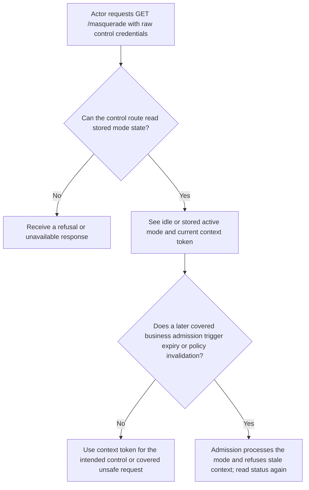
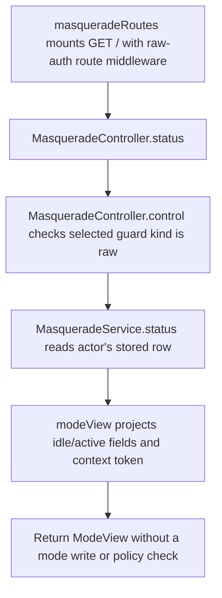

# US-ACTOR-06 — Read support mode status and context

As a signed-in actor, I want to read my current support mode and context token so that I can show my mode state and submit a current control or business request.

**Status:** Current; source-reviewed HTTP control.
**Access:** Actor authenticates with the configured raw control guard. Status does not grant target access or permission to start or stop a mode.
**Entry:** Read `GET /masquerade`, mounted by `masqueradeRoutes()`; this is independent of starting or stopping a mode.
**Documentation:** [Read status and start](../../docs/guide/usage.md#read-status-and-start).
**Source:** [MasqueradeController.status](../../http/controllers.ts), [MasqueradeService.status](../../src/service.ts), [mode projection](../../src/mode_projection.ts).
**Coverage:** [HTTP controller tests](../../tests/http_controllers.spec.ts), [service transition tests](../../tests/core_service.spec.ts).

## Acceptance criteria

- The response shows the stored idle or active `ModeView` and a context token. An active stored row remains displayed as active even after its expiry until admission or cleanup processes it; status itself does not expire the mode, recheck policy, or write state.
- The context token identifies the current mode context for freshness checks; it does not authorize business access or replace route policy, context middleware, or the raw actor credential.

## User flow

## Code flow

Scope: raw-guarded status read. It projects the stored row without expiring or revalidating an active mode.

**Code references:** [route mount](../../http/control_routes.ts), [controller](../../http/controllers.ts), [service status](../../src/service.ts), [mode projection](../../src/mode_projection.ts)
