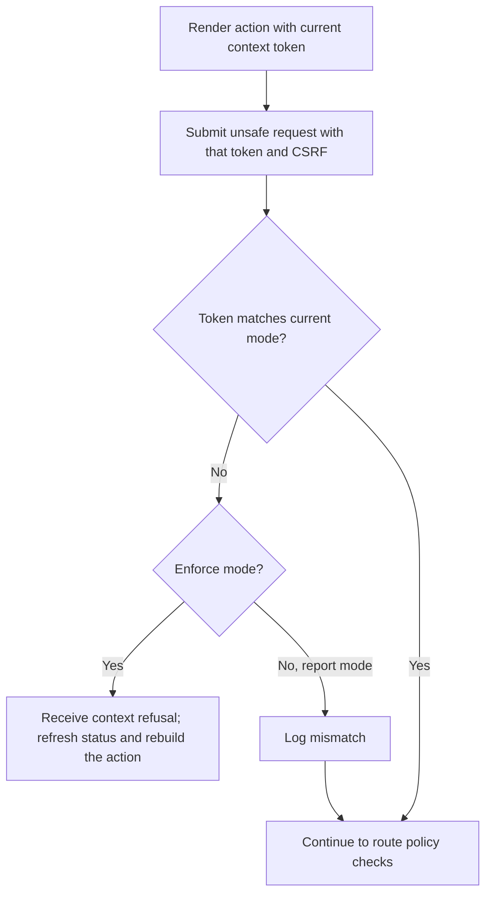
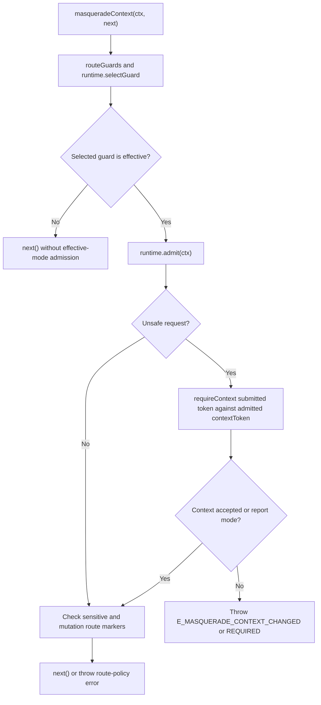

# US-CONTEXT-01 — Submit a request with the current mode context

As a signed-in actor using a covered form or client, I want to submit the context token captured with that action so that a stale request cannot run under a different support mode.

**Status:** Current; source-reviewed middleware behavior.
**Access:** Authenticated effective-guard business routes; token is bound to the raw actor and is not a credential. Integrated API tokens additionally need the configured `masquerade` ability.
**Entry:** `_masqueradeContext` on a form or `X-Masquerade-Context` on a client request; unsafe methods also retain the host CSRF requirement.
**Documentation:** [Context token contract](../../docs/guide/glossary.md), [JSON client](../../docs/guide/clients/json.md), [security](../../docs/guide/security.md#context-tokens-and-browser-clients).
**Source:** [masqueradeContext](../../http/context_middleware.ts), [requireContext](../../src/context_token.ts).
**Coverage:** [Context middleware tests](../../tests/http_context_middleware.spec.ts), [context token tests](../../tests/context_token.spec.ts).

## Acceptance criteria

| Field or header        | Control                          | Required/default/conditions                                                           |
| ---------------------- | -------------------------------- | ------------------------------------------------------------------------------------- |
| `_masqueradeContext`   | Hidden form field                | Current token from the rendered action; used for unsafe form requests                 |
| `X-Masquerade-Context` | HTTP header                      | Current token from `GET /masquerade`; used for unsafe client requests                 |
| Shield CSRF token      | Host form/client field or header | Still required by cookie-authenticated writes; Masquerade context does not replace it |

- If both context transports are supplied, they must match. In enforce mode, missing or stale context on an unsafe request is rejected. HTTP control bodies are limited to 8 KiB; JSON and URL-encoded forms are supported, multipart and unknown fields are refused.
- State-changing start and stop rotate context; an authorized idle/absent stop returns unchanged context; clients refresh status and rebuild the action instead of fetching a new token and replaying old intent.
- On API token routes, the token ability is checked separately from context freshness and cannot upgrade the mode access level.

## User flow

## Code flow

Scope: router middleware on effective routes; context enforcement must run after auth initialization and before the handler.

**Code references:** [middleware](../../http/context_middleware.ts), [requireContext](../../src/context_token.ts), [security contract](../../docs/guide/security.md#context-tokens-and-browser-clients), [middleware tests](../../tests/http_context_middleware.spec.ts).
