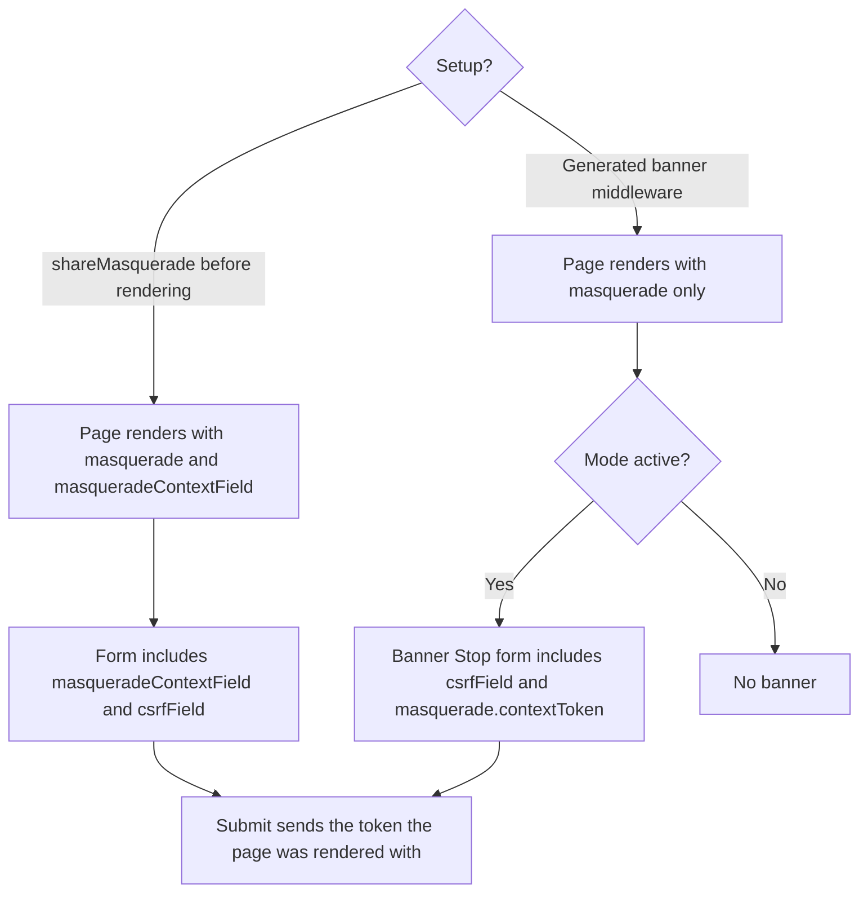
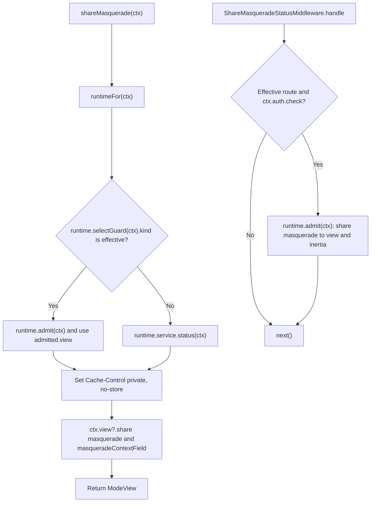

# US-CONTEXT-02 — Show mode status and the context field in Edge views

As an application developer rendering Edge pages, I want the current mode status and a hidden context field available to my views so that a banner can show the active support mode and a form can submit the context token it was rendered under.

**Status:** Current; source-reviewed helper. The `--banner` scaffold is optional.
**Access:** Host controller or middleware that runs on a route whose handler renders an Edge view; the route may use the effective or a raw guard.
**Entry:** Call `await shareMasquerade(ctx)` from `@kevinjohn/adonisjs-masquerade/http` before rendering, or generate the status middleware and banner with `node ace configure @kevinjohn/adonisjs-masquerade --banner` (see US-SETUP-01).
**Documentation:** [Context tokens and browser clients](../../docs/guide/security.md#context-tokens-and-browser-clients), [Edge forms](../../docs/recipes/routes-and-forms.md#edge).
**Source:** [shareMasquerade and contextField](../../http/edge.ts), [status middleware stub](../../stubs/configure/status_middleware.stub), [banner stub](../../stubs/configure/banner_edge.stub).
**Coverage:** [Edge helper tests](../../tests/http_edge.spec.ts).

## Acceptance criteria

- `shareMasquerade(ctx)` shares two Edge values: `masquerade` (the safe `ModeView`) and `masqueradeContextField()`, which renders `<input type="hidden" name="_masqueradeContext" value="...">` with the token HTML-escaped. It returns the `ModeView`.
- On an effective-guard route it shares the request's memoized admission, so the view cannot show a mode newer than the one the handler ran under. On any other route it shares read-only status; it does not admit, invalidate or apply `canUseRequest`.
- When the context has no Edge `view`, the call still returns the mode and shares nothing.
- The hidden field carries the context token only. Cookie-authenticated forms still need Shield's `csrfField()` alongside it.
- The `--banner` scaffold's status middleware shares only `masquerade` (to Edge and Inertia) on effective, authenticated routes, and its banner reads `masquerade.contextToken` directly. It does not share `masqueradeContextField`.

## User flow

## Code flow

Scope: the `shareMasquerade` helper and the generated status middleware; form handling is covered by US-CONTEXT-01.

**Code references:** [Edge helpers](../../http/edge.ts), [status middleware stub](../../stubs/configure/status_middleware.stub), [banner stub](../../stubs/configure/banner_edge.stub), [banner option in configure](../../configure.ts), [security guide](../../docs/guide/security.md#context-tokens-and-browser-clients).
