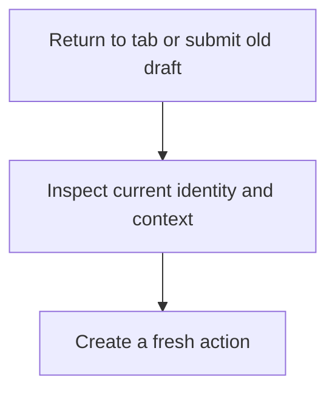
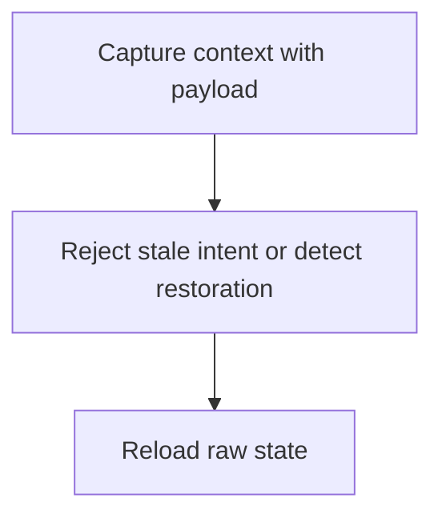

# US-CONTEXT-03 — Recover a stale or restored browser workspace

As a support actor, I want to revalidate the identity behind my open workspace so that a restored draft or delayed response cannot silently apply to another account.

**Status:** Current under the stated integration.
**Access:** Signed-in example operator
**Entry:** Native-session /support/json and the example Inertia React or Vue workspace.
**Documentation:** [Same-origin JSON](../../docs/guide/clients/json.md), [React](../../docs/guide/clients/react.md), [Vue](../../docs/guide/clients/vue.md).
**Source:** [JSON client](../../examples/native-session/resources/js/demo_json.js), [React history](../../examples/inertia-react/inertia/support_history.ts), [Vue history](../../examples/inertia-vue/inertia/support_history.ts).
**Coverage:** [JSON browser journey](../../examples/native-session/tests/browser/demo_json.spec.ts), [React journey](../../examples/inertia-react/tests/browser/support_journey.spec.ts), [Vue journey](../../examples/inertia-vue/tests/browser/support_journey.spec.ts).

## Acceptance criteria

- Keep the original context with each payload. Cookie-based unsafe requests also need Shield CSRF protection. A 409 or 428 requires inspection and a deliberate new action. A 503 after a transition can have an unknown outcome; inspect raw status before deciding what to do.
- The JSON example keeps raw status and stop available when an effective read fails. It freezes customer actions at the fixed deadline, checks visibility changes and discards older responses.
- The Inertia hosts clear history on the rendered destination after successful start, stop or logout. Browser restorations after support use return to the raw workspace. Revalidate before exposing identity-bound actions.

## User flow

## Code flow

