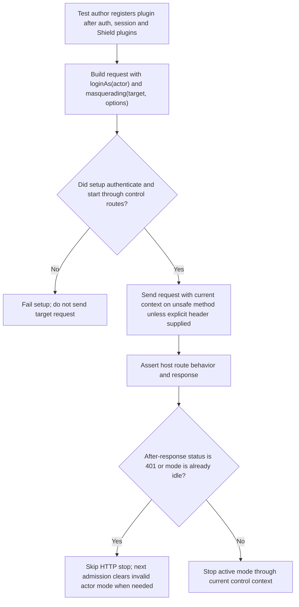
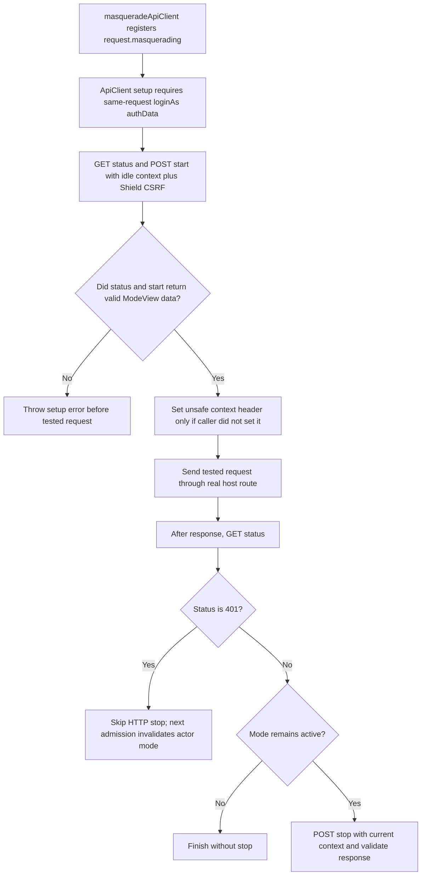

# US-TESTING-01 — Exercise support mode in API client tests

As an application test author, I want to exercise a real support mode through the API client so that my route tests include the host's authentication, context, policy and audit boundaries.

**Status:** Current; source-reviewed Japa API-client plugin.
**Access:** Register `masqueradeApiClient()` after auth, session and Shield API-client plugins. The same request must use `loginAs(actor)` before `masquerading(target, options)`.
**Entry:** In an API test, chain `.loginAs(actor).masquerading(target, options)` before sending the request.
**Documentation:** [Testing your routes](../../docs/guide/testing.md)
**Source:** [`plugins/api_client.ts`](../../plugins/api_client.ts)
**Coverage:** [`tests/api_client_plugin.spec.ts`](../../tests/api_client_plugin.spec.ts), [native-session helper scenario](../../examples/native-session/tests/functional/masquerading_helper.spec.ts)

## Acceptance criteria

- `target` is a model with an `id` or a string, number or bigint ID. Options are `access` (`view` by default or `edit`), `reason`, `durationSeconds` and `prefix`; per-request prefix overrides the plugin prefix, whose default is `/masquerade`.
- Before the requested route, the plugin uses the `loginAs` actor's credentials to read status and start through the real control routes with the current status context. The host's limiter, policy callbacks, security-stamp checks and audit path therefore run.
- The plugin adds the active context header to unsafe methods only when the request does not already carry one; an explicitly supplied header is preserved so tests can exercise stale or mismatched context. Cookie-authenticated unsafe requests still need Shield CSRF.
- A missing `loginAs` identity or an invalid status/start response fails the request setup; the protected request is not sent unmasked by mistake.
- After the response, the plugin reads status and stops only if the response is not 401 and the mode remains active. A 401 skips HTTP stop; the next admission invalidates the mode. This is an after-response cleanup path, not a guarantee that every interruption runs stop.

## User flow

## Code flow

Scope: Japa API client test plugin through the host's actual control routes and the tested route.

**Code references:** [plugin](../../plugins/api_client.ts), [testing guide](../../docs/guide/testing.md), [real control routes](../../http/control_routes.ts), [plugin tests](../../tests/api_client_plugin.spec.ts)
