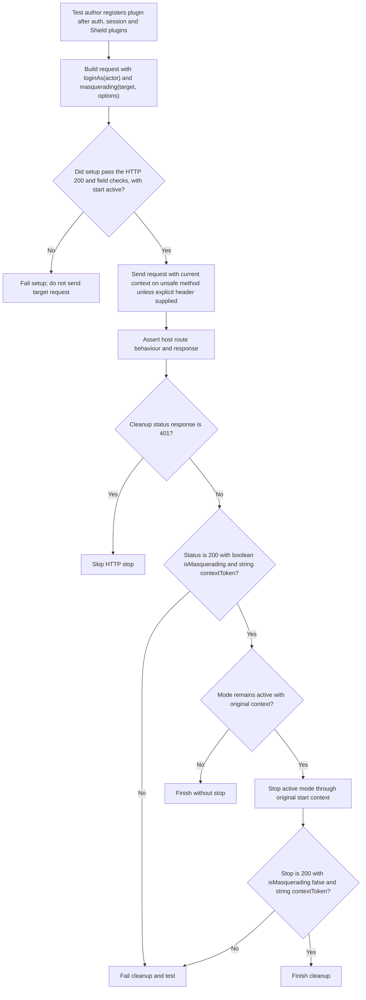
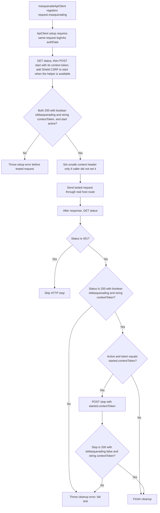

# US-TESTING-01 — Exercise support mode in API client tests

As an application test author, I want to exercise a real support mode through the API client so that my route tests include the host's authentication, context, policy and audit boundaries.

**Status:** Current; source-reviewed Japa API-client plugin.
**Access:** Register `masqueradeApiClient()` after auth, session and Shield API-client plugins. The same request must have `loginAs(actor)` credentials when setup runs.
**Entry:** In an API test, chain `.loginAs(actor).masquerading(target, options)` before sending the request.
**Documentation:** [Testing your routes](../../docs/guide/testing.md)
**Source:** [`plugins/api_client.ts`](../../plugins/api_client.ts)
**Coverage:** [`tests/api_client_plugin.spec.ts`](../../tests/api_client_plugin.spec.ts), [native-session helper scenario](../../examples/native-session/tests/functional/masquerading_helper.spec.ts)

## Acceptance criteria

- `target` is a model with an `id` or a string, number or bigint ID. Options are `access` (`view` by default or `edit`), `reason`, `durationSeconds` and `prefix`; per-request prefix overrides the plugin prefix, whose default is `/masquerade`.
- Before the requested route, the plugin uses the `loginAs` actor's credentials to read status and start through the real control routes with the current status context. The host's limiter, policy callbacks, security-stamp checks and audit path therefore run.
- The plugin adds the active context header to unsafe methods only when the request does not already carry one; an explicitly supplied header is preserved so tests can exercise stale or mismatched context. Cookie-authenticated unsafe requests still need Shield CSRF.
- Setup requires `loginAs`. Status and start must return HTTP 200 with a boolean `isMasquerading` and a string `contextToken`. Status accepts either state. Start must return `isMasquerading: true`. A failed check prevents the protected request.
- After the tested response, the plugin reads cleanup status and stops only if the mode is still active with the exact context token returned by setup. This is independent of the tested response status. A cleanup status 401 skips HTTP stop; a later admission may invalidate an ineligible actor's mode. Other cleanup responses must pass the same HTTP 200 and field checks. Cleanup status accepts either state, and stop must return `isMasquerading: false`. A failed check fails cleanup and the test. This is an after-response cleanup path, not a guarantee that every interruption runs stop.

## User flow

## Code flow

Scope: Japa API client test plugin through the host's actual control routes and the tested route.

**Code references:** [plugin](../../plugins/api_client.ts), [testing guide](../../docs/guide/testing.md), [real control routes](../../http/control_routes.ts), [plugin tests](../../tests/api_client_plugin.spec.ts)
