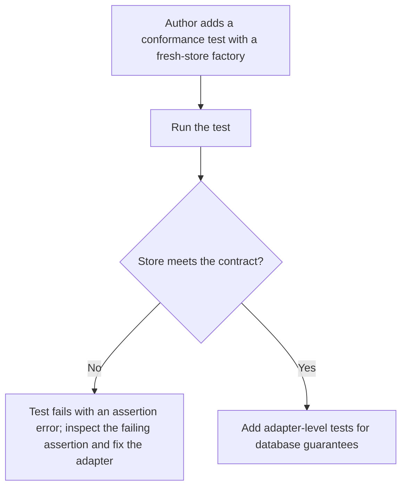
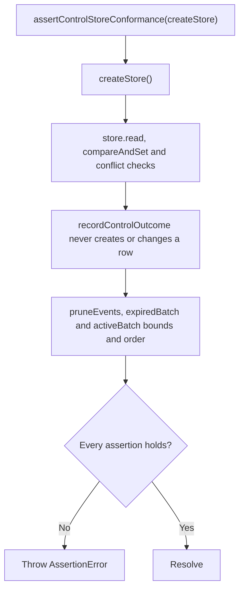

# US-TESTING-02 — Verify a custom control store against the package contract

As an application developer with a custom control store, I want to run the package's conformance suite against it so that behavior the package relies on is checked before the store is used.

**Status:** Current; source-reviewed test helper, not runtime-tested.
**Access:** Application test author with a factory that returns a fresh, isolated store per call.
**Entry:** `await assertControlStoreConformance(createStore)` from `@kevinjohn/adonisjs-masquerade/testing`, inside a test.
**Documentation:** [Run the conformance suite](../../docs/guide/custom-stores.md#run-the-conformance-suite).
**Source:** [assertControlStoreConformance](../../testing/control_store_conformance.ts), [MemoryControlStore](../../testing/memory_control_store.ts).
**Coverage:** [Conformance rejection tests](../../tests/control_store_conformance.spec.ts), [memory store tests](../../tests/memory_control_store.spec.ts).

## Acceptance criteria

- `createStore` is called once per run and must return a clean, isolated store.
- The suite throws an assertion error when the store breaks the observable contract, for example owner isolation, detached reads, one winner among competing compare-and-set calls, revision and event agreement, control outcomes that create or change a mode row, expiry and active batch ordering, or bounded event pruning.
- A pass does not prove database isolation or behavior under independent connections; the guide asks for adapter-level tests for those.
- `MemoryControlStore` is an in-process test utility, not a production persistence choice.

## User flow

## Code flow

Scope: the exported helper only; adapter implementations are host-owned.

**Code references:** [conformance helper](../../testing/control_store_conformance.ts), [custom stores guide](../../docs/guide/custom-stores.md#run-the-conformance-suite), [rejection tests](../../tests/control_store_conformance.spec.ts).

## Production store acceptance

A host using Lucid applies the migration generated by configure. Its schema helpers create the mode and event tables and reverse them on rollback. Use the complete namespace, actor ID and actor incarnation as the owner key. Persist each successful revision and its event atomically. An unknown commit acknowledgement must allow the actor to inspect authoritative status before deciding whether to try a new action. The built-in adapter handles SQLite and PostgreSQL transaction failures separately.

**Source:** [Lucid store](../../stores/lucid.ts), [schema helpers](../../stores/lucid_schema.ts). **Coverage:** [migration and owner keys](../../tests/lucid_schema.spec.ts), [commit failure paths](../../tests/lucid_commit.spec.ts).
