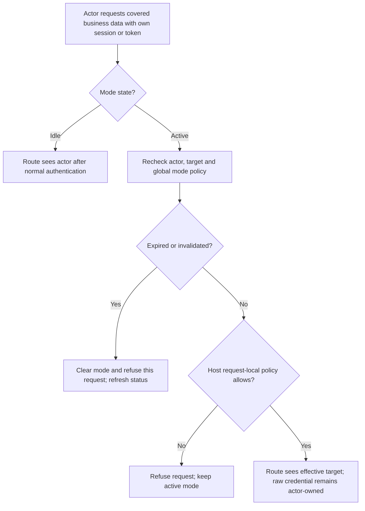
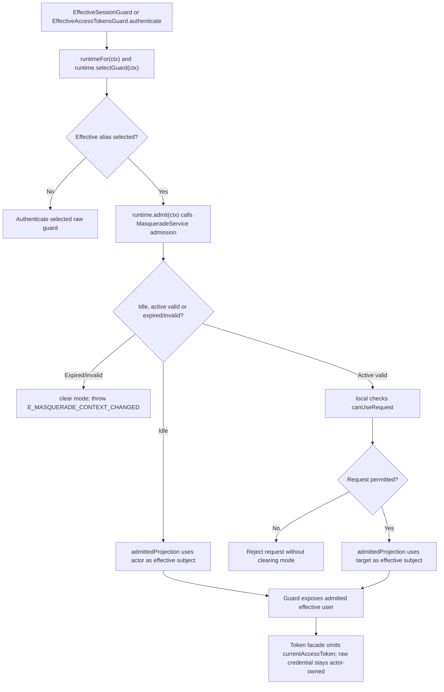

# US-ACTOR-02 — Read customer routes as the effective account

As an authorized support actor with an active mode, I want covered business routes to resolve the target account as their effective identity so that I can inspect the customer's view without acquiring the customer's credentials.

**Status:** Current; source-reviewed native-session and native access-token integrations.
**Access:** Actor retains their raw session or opaque access token; host `canMasquerade` and per-request admission determine whether the target is effective.
**Entry:** Business route uses `web_effective` or host-configured `api_effective` (or the configured effective alias), plus `masqueradeContext` after auth initialization.
**Documentation:** [Use the effective customer identity](../../docs/guide/usage.md#use-the-effective-customer-identity), [security identity boundary](../../docs/guide/security.md#actor-target-and-scope).
**Source:** [EffectiveSessionGuard](../../auth/effective_session_guard.ts), [EffectiveAccessTokensGuard](../../auth/effective_access_tokens_guard.ts), [request admission](../../src/service.ts).
**Coverage:** [Session guard tests](../../tests/effective_session_guard.spec.ts), [access-token guard tests](../../tests/effective_access_tokens_guard.spec.ts), [route guard tests](../../tests/route_guard_selection.spec.ts).

## Acceptance criteria

- In idle state, the effective guard authenticates the raw actor. In an admitted active mode, it exposes the target user for covered business routes while the raw guard remains the credential owner.
- The service rechecks actor and target eligibility, security stamps and `canMasquerade` for active requests; edit modes also recheck `canEdit`.
- Expired or invalidated mode rejects the triggering request with context-changed behavior; it does not silently retry that request as the actor. A later new idle request uses the actor.
- A host `canUseRequest` refusal rejects only the current request and keeps the active mode unchanged.
- The effective access-token facade omits `currentAccessToken`; the raw token remains actor-owned. Host wiring selects the effective token guard explicitly.
- The package never logs in as the target, mints a target credential, or combines actor and target permissions.

## User flow

## Code flow

Scope: effective session or access-token guard through cached service admission; the host handler then applies its normal target-side authorization.

**Code references:** [Session facade](../../auth/effective_session_guard.ts), [access-token facade](../../auth/effective_access_tokens_guard.ts), [service admission and local policy](../../src/service.ts), [native access-token wiring](../../docs/guide/access-tokens.md), [security contract](../../docs/guide/security.md#actor-target-and-scope), [token guard tests](../../tests/effective_access_tokens_guard.spec.ts).
