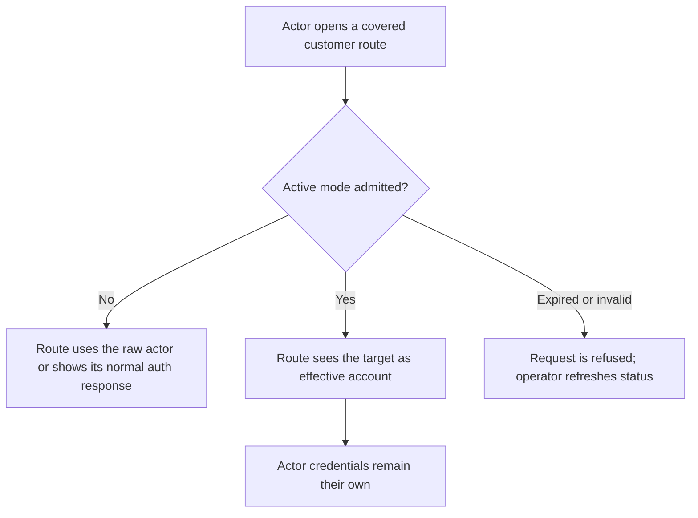
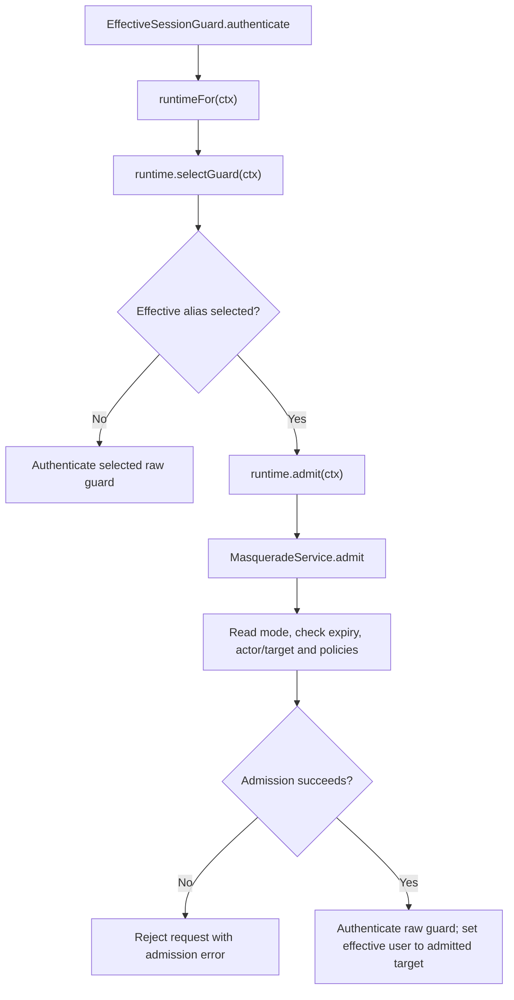

# US-ACTOR-02 — Read customer routes as the effective account

As an authorized support actor with an active mode, I want covered business routes to resolve the target account as their effective identity so that I can inspect the customer's view without acquiring the customer's credentials.

**Status:** Current; source-reviewed native-session integration.
**Access:** Actor retains raw session; host `canMasquerade` and per-request admission determine whether the target is effective.
**Entry:** Business route uses `web_effective` (or configured effective alias) and `masqueradeContext` middleware after auth initialization.
**Documentation:** [Use the effective customer identity](../../docs/guide/usage.md#use-the-effective-customer-identity), [security identity boundary](../../docs/guide/security.md#actor-target-and-scope).
**Source:** [EffectiveSessionGuard](../../auth/effective_session_guard.ts), [request admission](../../src/service.ts).
**Coverage:** [Effective guard tests](../../tests/effective_session_guard.spec.ts), [route guard tests](../../tests/route_guard_selection.spec.ts).

## Acceptance criteria

- In idle state, the effective guard authenticates the raw actor. In an admitted active mode, it exposes the target user for covered business routes while the raw guard remains the credential owner.
- The service rechecks actor and target eligibility, security stamps and `canMasquerade` for active requests; edit modes also recheck `canEdit`.
- Expired or invalidated mode rejects the triggering request with context-changed behavior; it does not silently fall back to acting as the target.
- The package never logs in as the target, mints a target credential, or combines actor and target permissions.

## User flow

## Code flow

Scope: effective session guard and cached service admission; application handler and its own authorization follow this boundary.

**Code references:** [guard](../../auth/effective_session_guard.ts), [service admission](../../src/service.ts), [security contract](../../docs/guide/security.md#actor-target-and-scope), [route guard tests](../../tests/route_guard_selection.spec.ts).
